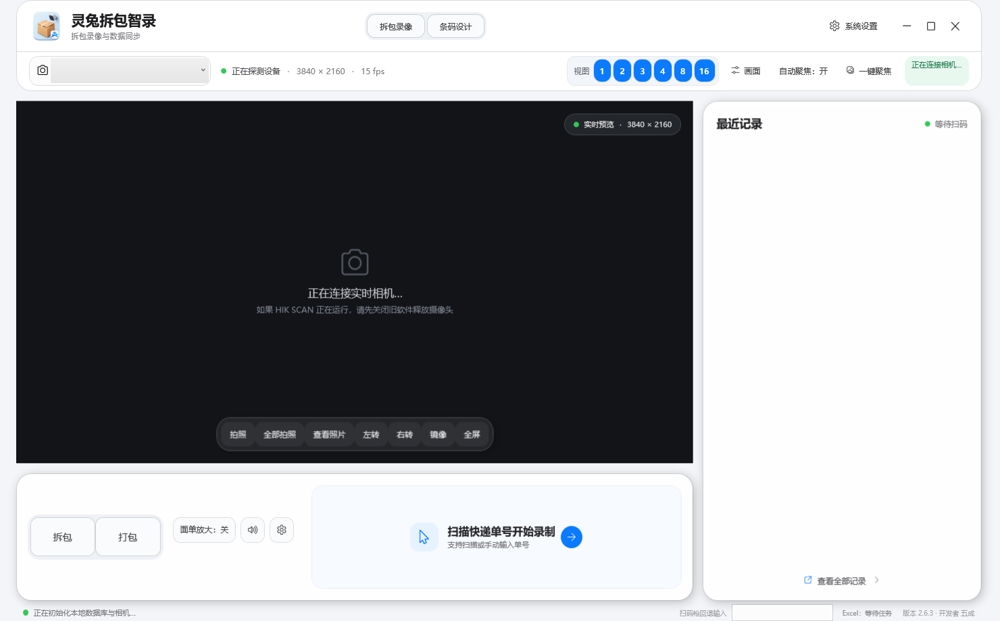
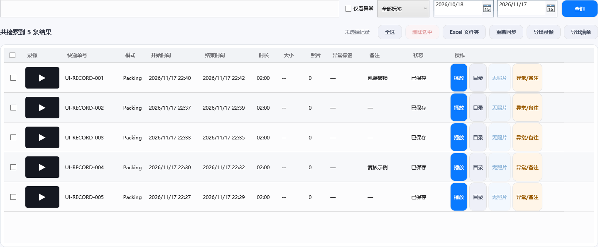
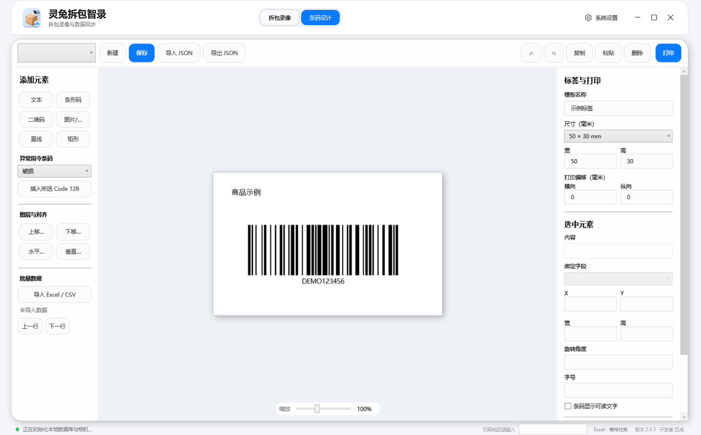

# Lingtu Unpack Recorder

[简体中文](README.md) | **English**

A Windows app for recording parcel unpacking and packing. Scan each parcel, find its recording later, sync records to Excel, or use an Android phone as a scanner.

> **2.6.3 is a prerelease.** The Windows installer is not code-signed yet, so SmartScreen may warn on first run.

**Quick links:** [Interface and features](#interface-and-core-features) · [Download and install](#download-and-install) · [Four-step start](#four-step-quick-start) · [User guide](docs/user-guide.en.md) · [FAQ](docs/user-guide.en.md#20-faq) · [License](#guides-privacy-and-license)

## Interface and core features

> These images are isolated renders of the 2.6.3 interface. Records and labels are examples; no camera was connected.

**The desktop interface is currently Chinese only.** Control names below are quoted in Chinese with an English explanation.

### 1. Scan to record unpacking / packing

- Choose a camera and 拆包 / 打包 (unpacking / packing), then scan a tracking number to start. Scan the same number again to finish, or scan a new one to switch parcels.
- Use the controls below the preview to take photos, rotate, mirror, or view full screen. Add exception tags and notes while recording.
- If the scanner is unavailable, enter the number at the bottom right.

### 2. Recent records, search, and playback

- Click 查看全部记录 (view all records) on the right of the main screen. Search by tracking number, note, date, or exception tag.
- Play or export a recording, open its folder, or view photos. The status column shows the Excel sync result.

### 3. Label design and printing

- Open 条码设计 (label design) at the top. Add text, barcodes, QR codes, or images, then set the label size and print.
- Import Excel / CSV data to make labels in batches. Try a test print first.

## More features

- **Excel / WPS sync:** choose or generate a workbook under 系统设置 → 存储与数据 (settings → storage and data). If the file is in use, the app waits and retries.
- **Phone companion:** use an Android phone as a scanner or camera. Connect both devices to the same LAN and pair under 系统设置 → 手机协同 (settings → phone companion).

## Download and install

- [Windows installer v2.6.3](https://github.com/907609732/lingtu-recorder/releases/download/v2.6.3/EcommerceUnpackRecorder-win-Setup.exe)
- [Android APK v2.6.3](https://github.com/907609732/lingtu-recorder/releases/download/v2.6.3/EcommerceUnpackRecorder-Android.apk)
- [All releases and notes](https://github.com/907609732/lingtu-recorder/releases)

The installer does not require the .NET SDK. SHA256 checksums are available on the release page.

## Four-step quick start

1. Download and install the Windows app; read the terms and privacy policy when starting it.
2. Choose a recording folder in the setup wizard; Excel can be skipped. If old data is found, 合并 (merge) is checked by default, so review it first.
3. Choose and test a camera under 系统设置 → 相机信息 (settings → camera). Start with a single camera.
4. Return to the main screen and scan a number to record. Find the result in the panel on the right.

Optional anonymous usage statistics are checked by default. Clear the checkbox or turn them off later under 系统设置 → 关于 (settings → about).

## Lingtu e-commerce toolkit

- **This project: Lingtu Unpack Recorder** — Windows unpacking/packing recording and record management.
- [E-commerce Purchase Order Export](https://github.com/907609732/lingtu-order-export/blob/master/docs/README.en.md) — buyer purchase-order organization with Excel/CSV export.
- [Lingtu AI E-commerce Customer Service](https://github.com/907609732/LTTLT-AI-Customer-Service) — store knowledge management and AI-assisted customer reception (Chinese only).

Choose the tools you need and see each project for details.

## Guides, privacy, and license

- [User guide (English)](docs/user-guide.en.md): scanning, cameras, phone pairing, label design, migration, uninstall, troubleshooting.
- [Privacy policy](docs/PRIVACY.md) · [Terms](docs/TERMS.md) · [Security and vulnerability disclosure](SECURITY.md) — these documents are currently in Chinese.
- [MIT License](LICENSE) · [Third-party notices](THIRD_PARTY_NOTICES.md)

---

[简体中文](README.md) | **English** · [User guide](docs/user-guide.en.md)
