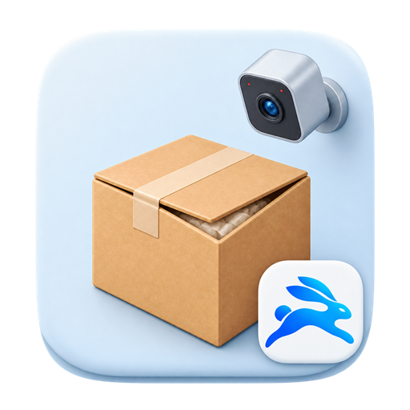

# Lingtu Unpack Recorder

[简体中文](README.md) | **English**

<p align="center">
  
</p>

Lingtu Unpack Recorder is a free, open-source Windows system for recording parcel unpacking and packing, working with an Android phone, and synchronizing data. It does not modify HIK SCAN or contain Hikvision source code, trademarks, or proprietary assets.

[Website](https://record.lttlt.top) · [Brand upgrade and data retention](docs/operations/brand-upgrade.md) (Chinese) · [2.6.3 prerelease notes](docs/releases/2.6.3.md) (Chinese)

Version 2.6.3 retains the existing interface, layout, and workflows while updating the brand name and icons and adding help links.

## Download

- [Windows installer](https://github.com/907609732/lingtu-recorder/releases/download/v2.6.3/EcommerceUnpackRecorder-win-Setup.exe)
- [Android app](https://github.com/907609732/lingtu-recorder/releases/download/v2.6.3/EcommerceUnpackRecorder-Android.apk)
- [Releases and release notes](https://github.com/907609732/lingtu-recorder/releases)
- [Source repository](https://github.com/907609732/lingtu-recorder)

The Windows app uses a per-user Velopack installer. Updates download in the background and install after recording is idle and the user confirms. The installer does not yet have a trusted code-signing certificate and is distributed as a prerelease; Windows SmartScreen may show a warning. The release page provides SHA256 checksums; GitHub Actions builds also provide provenance where described by that release and its `build-info.json`.

## Features

- **HIK SCAN-compatible synchronization:** monitor unpacking and packing folders, wait for MP4 files to finish writing, extract tracking numbers and times, store records in SQLite, and synchronize to Excel with retries. The first run indexes existing videos without automatically backfilling Excel.
- **Excel:** append after the last nonempty cell in column B; write a real date in A, tracking number as text in B, platform formula in C, and the compatibility marker `【拆包智录】` plus exceptions and notes in E. D and F remain empty. Workbooks are backed up and saved with temporary files and atomic replacement; missing date styles are repaired for Excel and WPS compatibility.
- **Desktop recording:** live preview, scan to start or finish, automatically switch to a new parcel when its number is scanned, manual stop, duplicate detection, timeout reminders, voice prompts, and recent results.
- **Exceptions and notes:** scan command barcodes or use buttons for damage and substitution; multiple tags can be applied and undone. Notes autosave after 500 ms. Exceptions appear in watermarks, filenames, SQLite, history, and Excel without overwriting manually entered Excel notes.
- **Thermal barcode designer:** text, images, Code 128, QR codes, shapes, layers, alignment, rotation, undo/redo, millimeter dimensions, print offsets, Excel/CSV field mappings, batch quantities, versioned JSON templates, and Windows printer drivers. Recording can continue while editing.
- **Camera recording:** the compatibility path uses Windows Media Foundation and OpenCV and requests 3840×2160 at 15 fps by default. Eligible cameras are detected, time and tracking number watermarks are added, and a temporary recording is renamed only after the encoder closes successfully.
- **Multiple views and storage:** layouts support 1, 2, 3, 4, 8, or 16 views. Each camera and optional composite has its own writer. Composite video is enabled by default for 1–4 cameras; above four, individual recordings take priority. A storage pool assigns each session to a healthy disk and checks capacity and reserved space; changing the pool does not move existing recordings.
- **Media checks:** the source checks for GStreamer 1.28.5, required plugins, and a usable H.264 encoder, and separately audits FFmpeg 8.1.2 against an LGPL distribution allowlist. These checks do not mean the runtime is installed or that 8/16-camera hardware acceptance is complete.
- **Video sources and controls:** automatic or selected local USB/UVC, iVCam and other Windows cameras; RTSP/HTTP IP cameras and Hikvision NVR/DVR channels. Network passwords are protected with Windows DPAPI. Controls include focus, image adjustments, snapshots, rotation, mirror, and full screen.
- **History:** filter by tracking number, notes, dates, and exception tags; view thumbnails, timestamps, size, and synchronization status; edit notes, jump to exception times, open folders, retry Excel, export video/CSV, and select or delete records in batches.
- **Scanning and local processing:** configurable tracking-number length, prefix, suffix, and scan interval; Windows Raw Input device isolation with an input-field fallback; offline document edge detection, perspective correction, rotation, image enhancement, and barcode/QR recognition. Cloud OCR is not called by default; without a local model, OCR reports that it is not configured.
- **Local API and setup:** the compatibility API listens only on `127.0.0.1` and protects its key with DPAPI. A first-run wizard configures the recording folder and optionally an Excel workbook. The `.unpackvision` portable index contains record metadata and relative paths for previewing and merging recovery without moving or overwriting recordings.

## Camera capacity and Android collaboration

The 2.5.2 engineering foundation adds 8/16-camera layouts, multiple recording disks, and IP camera discovery to the earlier LAN and four-camera features. It remains a prerelease:

- Up to 16 USB, virtual, phone, IP camera, or Hikvision recorder channels can be configured. Actual capacity depends on end-to-end performance testing on each computer.
- By default 1–4 cameras save individual streams and a 1080p composite; 5–16 cameras prioritize individual streams. The primary camera is required; writer failure or five seconds without a frame safely ends the session. Secondary cameras reconnect and gaps remain auditable.
- The 60-second test for 5–16 cameras is tied to the camera, composite, and enabled disk configuration; repeat it after changes. Each enabled disk is tested. History playback is currently limited to four synchronized views by default.
- Multi-disk removal, drive-letter changes, and capacity warnings still require physical disk acceptance. This repository does not record the two-hour 8/16-camera, 100-parcel, and disk-failover acceptance needed to claim stable production readiness. Existing `VideoPath`, `RecordingRoot`, Excel, folder, and API compatibility is preserved.
- `UnpackVision.StationHost` runs in the user session and receives scan commands. `IScanCommandRouter` stores idempotent receipts in SQLite. The Android scanner can optionally trigger recording or append to Excel.
- Android provides smart camera and phone scanner modes. The exception remote can view the active recording, add or undo tags, capture a problem image, add notes, and stop recording, with Chinese voice and vibration feedback after desktop confirmation. CameraX supplies frames to RootEncoder 2.8.0 and ZXing-C++ 3.1.0; three stable detections are required, and the same code cannot trigger again until it has left the scan area for 1.2 seconds.
- Desktop pairing uses a one-time QR code valid for five minutes and allows LAN address selection. Each phone has its own key and Android Keystore-protected token; the computer stores token hashes. Devices can be inspected and revoked. MediaMTX 1.18.2 starts on demand with device-specific RTSPS paths, `camera:publish` and `video:read` authorization, and HTTPS/WHEP preview.
- Station APIs provide paginated records, events, thumbnails, and video with Range/206 and ETag without exposing local paths. LAN listeners bind loopback and available private IPv4 addresses. Android can recover connections using DNS-SD/mDNS, hotspot, tethering, or the USB debugging reverse channel; it separately checks station availability and desktop readiness.
- Mobile control uses HTTPS with a self-signed station certificate pinned by SHA256, and media publishing uses RTSPS. Legacy plaintext pairing credentials must be paired again after migration. The development ADB fallback permits plaintext only on `127.0.0.1`, never across the LAN. MediaMTX is downloaded with SHA256 verification instead of committing its binary; release packages include it and its license.

On first launch, the terms and privacy policy are shown before camera use, scanning, or online updates. With separate consent, the app may send one minimal anonymous daily activity event per Beijing calendar day to a fixed Cloudflare HTTPS endpoint. It does not collect hardware fingerprints, tracking numbers, recordings, Excel files, paths, or accounts. Disabling statistics stops requests and removes the local random statistics key.

Station endpoints include:

```text
GET    /api/v1/records
GET    /api/v1/records/{id}
GET    /api/v1/records/{id}/thumbnail
GET    /api/v1/records/{id}/video
GET    /api/v1/records/{id}/events
GET    /api/v1/devices
POST   /api/v1/devices/{id}/revoke
DELETE /api/v1/devices/{id}
GET    /api/v1/stations/{id}/state
POST   /api/v1/stations/{id}/scans
GET    /api/v1/stations/{id}/live
```

## Safe operation

- The compatibility service reads the recording folders and can run alongside HIK SCAN. The standalone recorder needs exclusive camera access; exit HIK SCAN before recording with it.
- For an initial trial, copy the workbook and point `Excel__WorkbookPath` to the copy. A workbook locked by Excel or Plastic SCM is retried rather than forcibly modified. Backups default to `%LOCALAPPDATA%\UnpackVision\Backups`.

## Quick start

Windows 10/11 and the [.NET 10 SDK](https://dotnet.microsoft.com/download/dotnet/10.0) are required. Scripts prefer a root `.dotnet` installation if present, otherwise the system SDK.

```powershell
powershell -ExecutionPolicy Bypass -File .\scripts\build.ps1
powershell -ExecutionPolicy Bypass -File .\scripts\run-service.ps1
powershell -ExecutionPolicy Bypass -File .\scripts\run-app.ps1
```

The service monitors HIK folders and synchronizes SQLite and Excel; the app starts the standalone recorder. When release output exists, `Start-Sync-Service.cmd` and `Start-UnpackVision.cmd` can also be used.

1. Accept the agreements and select a recording folder in the setup wizard.
2. Select an Excel workbook, create the standard six-column workbook, or skip it for now.
3. Review existing recordings and portable-index recovery, confirm, and test writing.
4. Exit HIK SCAN and ensure the camera is free.
5. Scan a tracking number to start; scan it again to finish, or scan a new number to switch parcels. Use manual stop if the scanner fails.

To migrate, preserve or copy the complete recording folder and workbook, select them on the new computer, review and confirm the recovery merge, and reconfigure cameras and phone pairing. Phone keys are not transferred with the portable index.

## Compatibility service configuration

Defaults are in `src/UnpackVision.Service/appsettings.json`. Environment variables override them; double underscores represent nested keys:

```powershell
$env:Excel__WorkbookPath = 'E:\path\returns.xlsx'
$env:HikCompatibility__UnpackingDirectory = 'D:\Program Files\海康威视\HIK SCAN\storage\LogisticsUnpacking'
$env:HikCompatibility__PackingDirectory = 'D:\Program Files\海康威视\HIK SCAN\storage\LogisticsPaking'
powershell -ExecutionPolicy Bypass -File .\scripts\run-service.ps1
powershell -ExecutionPolicy Bypass -File .\scripts\run-service.ps1 -ShowApiKey
```

Except for the minimal `/api/v1/health` endpoint, requests require `X-UnpackVision-Key: <local API key>`. The service exposes record, tracking-number, tag, note, connector retry, health, image processing, barcode, and OCR health endpoints; see the [Chinese README](README.md#兼容同步服务配置) for the complete list.

## Data locations

- SQLite: `%LOCALAPPDATA%\UnpackVision\unpackvision.db`
- Settings: `%LOCALAPPDATA%\UnpackVision\settings.json`
- Thermal label templates: `%LOCALAPPDATA%\UnpackVision\Templates`
- Diagnostic logs: `%LOCALAPPDATA%\UnpackVision\Logs` (daily and 20 MB rotation, retained up to 14 days)
- Recordings: `%USERPROFILE%\Videos\UnpackVision\Unpacking` or `Packing`
- Portable index: `.unpackvision` inside the recording folder; back it up with the recordings.
- API key: `%LOCALAPPDATA%\UnpackVision\api-key.protected`

Settings include scan rules, exception barcodes, maximum recording duration, and working mode. Tracking numbers are stored as text so letters, hyphens, and leading zeroes are preserved.

## Safe uninstall

Use **Settings → About → Uninstall and data retention → Safe uninstall**. By default, only the application, shortcuts, and uninstall registration are removed; databases, settings, pairing data, recordings, and Excel are retained. Permanent cleanup requires two warnings and verifies `.unpackvision/workspace.json` against the current workspace ID; it is refused if verification fails. Cleanup is restricted to `Unpacking`, `Packing`, `Snapshots`, `.unpackvision`, and `%LOCALAPPDATA%\UnpackVision`; Excel and other files in the recording folder remain. Uninstalling through Windows Settings retains business data by default.

## Build, test, and release

```powershell
powershell -ExecutionPolicy Bypass -File .\scripts\build.ps1
powershell -ExecutionPolicy Bypass -File .\scripts\publish.ps1
powershell -ExecutionPolicy Bypass -File .\scripts\build-android.ps1
```

The Android script checks the system Android Studio/JBR and SDK and handles Windows paths containing Chinese characters. The debug APK is written to `mobile\UnpackVision.Android\app\build\outputs\apk\debug\app-debug.apk`. For the development-only ADB fallback and pinned MediaMTX download:

```powershell
powershell -ExecutionPolicy Bypass -File .\scripts\enable-adb-usb-fallback.ps1
powershell -ExecutionPolicy Bypass -File .\scripts\fetch-mediamtx.ps1
```

Release output is stored in `artifacts\release-output`. The Windows installer updates the desktop app, StationHost, compatibility service, and licensed MediaMTX together. Android releases include an APK, update manifest, and SHA256. Example for the 2.5.2 prerelease:

```powershell
powershell -ExecutionPolicy Bypass -File .\scripts\build-signed-android.ps1
powershell -ExecutionPolicy Bypass -File .\scripts\package-release.ps1 `
  -Version 2.5.2 `
  -AndroidApk .\mobile\UnpackVision.Android\app\build\outputs\apk\release\app-release.apk
```

The anonymous activity Worker is in `telemetry`; deployment requires copying `wrangler.example.toml`, creating a D1 database, and authorizing the developer's Cloudflare account. Clients send no statistics request without a configured production HTTPS endpoint.

## License, security, and future work

The project is licensed under the [MIT License](LICENSE). It is independently implemented; product names are used only to describe compatibility. See the [terms](docs/TERMS.md), [privacy policy](docs/PRIVACY.md), [security and vulnerability disclosure](SECURITY.md), [release notes](docs/releases/2.6.3.md), and [code-signing policy](docs/CODE_SIGNING.md). These linked documents are currently in Chinese unless otherwise indicated.

Stable Windows releases require a verifiable GitHub Actions build and trusted Authenticode signature; unsigned builds remain prereleases. `ISyncConnector` allows additional connectors beyond Excel. DingTalk AI tables, website integration, signed webhooks, PaddleOCR model packages, audio tracks, and virtual cameras remain extension or acceptance work as described in the Chinese README.
