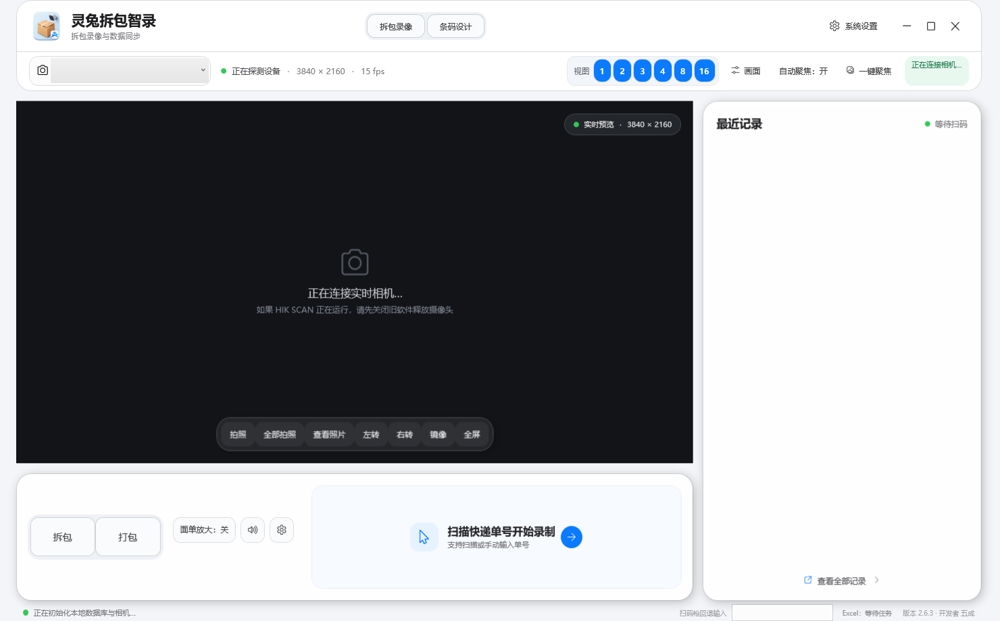

# 灵兔拆包智录

**简体中文** | [English](README.en.md)

<p align="center">
  
</p>

这是一个面向中小商家的零成本、开源 Windows 拆包/打包录像、手机协同与数据同步系统。它不会修改 HIK SCAN，也不包含海康的源代码、商标或专有资源。

**快速导航**：[下载安装](#下载与安装) · [界面预览](#软件界面) · [功能概览](#主要功能概览) · [新手教程](docs/user-guide.md) · [常见问题](docs/user-guide.md#20-常见问题) · [隐私与数据](#隐私与数据) · [数据位置](#数据位置) · [安全卸载](#安全卸载) · [源码构建](#源码构建测试与发布) · [许可证](#许可证与独立实现声明)

官网：[record.lttlt.top](https://record.lttlt.top) · [品牌升级与数据保留](docs/operations/brand-upgrade.md) · [2.6.3 预发布说明](docs/releases/2.6.3.md)

2.6.3 保留现有软件界面风格、布局和业务流程，更新了品牌名称与图标、增加帮助链接，并包含[发布说明](docs/releases/2.6.3.md)中列出的修复。安装版用户不需要安装 .NET SDK 或编译源码；源码构建只对开发者有意义。

## 软件界面



图注：灵兔拆包智录 2.6.3 主界面的**隔离渲染**截图，由本项目的 WPF 隔离渲染测试生成。该测试未连接相机、未加载任何个人设置或业务数据，图中不含真实单号与工作簿。它只用于说明界面布局，**不是实际录像效果、硬件兼容性或生产验收的通过证明**。

主界面自上而下分为：顶部“拆包录像 / 条码设计 / 系统设置”页面切换与视频源、视图（1/2/3/4/8/16）和预览控制；中部实时预览与画面操作按钮（拍照、全部拍照、查看照片、左转、右转、镜像、全屏）；底部“拆包 / 打包”模式、“面单放大”、语音开关、扫码开始提示与右侧“最近记录”。

## 下载与安装

- [Windows 安装器](https://github.com/907609732/lingtu-recorder/releases/download/v2.6.3/EcommerceUnpackRecorder-win-Setup.exe)
- [安卓手机 APP](https://github.com/907609732/lingtu-recorder/releases/download/v2.6.3/EcommerceUnpackRecorder-Android.apk)
- [最新版本与更新说明](https://github.com/907609732/lingtu-recorder/releases)
- [源码仓库](https://github.com/907609732/lingtu-recorder)

Windows 端使用 Velopack 每用户安装器，后续更新由软件后台下载并在录像空闲、用户确认后安装，不需要手工覆盖旧文件。当前安装器尚未取得代码签名证书，只作为 Prerelease 提供，首次下载可能出现 SmartScreen 提示。发布页提供 SHA256；GitHub Actions 完成构建时另提供构建来源证明，具体以该版本说明和 build-info.json 为准。

普通用户的三步安装流程：

1. 在发布页下载 `EcommerceUnpackRecorder-win-Setup.exe`，并按该版本说明核对 SHA256。
2. 双击安装，按提示完成“每用户”安装；遇到 SmartScreen 提示时先确认下载来源确为本项目发布页。
3. 从开始菜单启动灵兔拆包智录，按首次向导选择录像目录，Excel 可以暂时跳过。

下载、校验、首启向导、扫码录像、手机配对、条码设计、兼容同步、迁移与卸载的完整操作步骤见 **[用户教程（中文）](docs/user-guide.md)**。

## 主要功能概览

- **录像**：实时预览、扫码开始、再次扫描结束、扫描新单号自动换单、手动结束、重复单号标识、超时提醒、语音提示，以及可选的异常自动截图。
- **数据**：录像完成后写入本机 SQLite，记录单号、起止时间、异常标签和备注，并按可靠重试队列同步到 Excel 或 WPS；Excel 被占用时等待而不是强写。
- **查证**：历史记录按单号、备注、日期和异常标签检索，可播放、跳转到异常时间点、导出录像与清单、查看同步状态。
- **手机协同**：安卓端可作为摄像头或扫码器使用，扫码器页面底部内嵌当前录像的异常控制（标签、备注、截图、停止），与电脑在同一专用局域网内配对使用。
- **条码**：内置热敏条码标签设计器，支持文本、条码、二维码、图片、形状、字段映射和批量打印。
- **兼容**：可以只读方式监控 HIK SCAN 的录像目录并同步，不修改 HIK SCAN 和原始 MP4。

## 完整功能与工程细节

### 录像、扫码与现场操作

- 独立录像桌面端：按实际拆包流程独立设计，包含持续实时预览、扫码开始、再次扫描当前单号结束、扫描新单号自动保存并开始下一单、手动停止、重复单号标识、超时提醒、语音提示和右侧最近结果。
- 相机录像：当前兼容路径使用 Windows Media Foundation + OpenCV，默认请求 3840x2160、15fps；自动探测满足分辨率的设备并排除不合格的虚拟相机，录像叠加时间与单号水印，先写临时文件，成功关闭编码器后再改为正式 MP4 文件名。
- 相机控制：自动聚焦、一键聚焦、亮度/对比度/锐度/饱和度、拍照、左转、右转、镜像和全屏预览。
- 视频源选择：主界面可在自动模式和 16 个本地相机序号间快速切换；指定本地相机时接受实际分辨率，支持 USB/UVC、iVCam 等 Windows 摄像头。设置页还支持通用 RTSP/HTTP IPC 视频流，以及按地址、端口、通道和主/副码流配置海康 NVR/DVR；网络密码使用 Windows DPAPI 加密保存。
- 单号配置：最短/最长长度、开头与结尾过滤和防误扫间隔。
- 扫码枪隔离：Windows Raw Input 按设备接收扫码，保留输入框作为兼容回退。

### 异常、备注与历史检索

- 异常标签与备注：录像中可扫描固定“破损”“调包”指令条码或点击快捷按钮，一个包裹可有多个标签并可撤销；备注 500ms 自动保存。异常会进入实时水印、录像文件名、SQLite、历史检索与 Excel E 列，人工 Excel 备注不会被覆盖。
- 录像历史与播放：按单号、备注、日期和异常标签筛选，显示缩略图、模式、起止时间、时长、大小和同步状态；可编辑异常/备注，播放时点击异常时间点直接跳转。支持打开目录、重新同步、导出录像/CSV、Ctrl/Shift 多选、全选和批量删除。历史窗口的“重新同步”会按 Excel 连接器重新排队**全部尚未成功的任务（等待、失败、处理中）**，不只是选中的记录；界面提示只写“失败或等待中”，实际范围以 `status <> 'Succeeded'` 为准。

### Excel 与数据安全

- HIK SCAN 兼容同步服务：监控拆包、打包录像目录，等 MP4 写入稳定后解析单号和起止时间，写入 SQLite，并通过可靠重试队列同步 Excel。
- 首次运行安全基线：第一次只登记已有历史录像，不自动补写 Excel；以后产生的新录像才自动进入同步队列。
- Excel 安全写入：只支持 `.xlsx`；工作表名必须精确为 `退货扫码单号`，前六列表头必须依次为 `扫码日期`、`快递单号`、`关联结果`、`金额`、`备注`、`图片凭证`，额外列不参与写入。按 B 列最后一个真实非空单元格追加，A 列写真实 Excel 日期并继承日期显示格式，B 列强制文本，D、F 保持空白，E 列继续写入兼容标记 `【拆包智录】` 并安全合并异常/备注。**C 列只有在工作簿同时存在旧版拼多多、淘宝、京东三张平台关联表时才写入平台关联公式，否则保持空白**。写入前备份，以临时文件和原子替换保存。同步时会安全修复日期列中缺少日期样式的序列值，兼容 Excel 和 WPS。

### 机位、存储与媒体运行时

- 2.5.2 多路预览基础：机位模型和主页布局支持 1、2、3、4、8、16 画面，预览分配不改变录像机位所有权；录像后端为各机位和可选合成片使用独立写入循环。1 至 4 路默认生成合成片，5 路以上默认优先保存各机位原片。
- 多硬盘存储池基础：旧录像目录自动成为第一个盘位；开始一单前把所有机位媒体整单分配到一个健康盘位，并按剩余百分比、预计可录时长和安全保留空间决定警告或拒绝。增加、删除、排序盘位不会移动已有录像。
- 生产媒体运行时检查：源码固定探测 GStreamer 1.28.5、必需插件和可实际启动的 H.264 编码器，并单独审计 FFmpeg 8.1.2 是否符合 LGPL 发布白名单。探测能力不等于当前电脑已安装运行时，也不等于 8/16 路实机验收已经完成。

### 初始配置、恢复与本地接口

- 首次配置向导：隐私协议后依次选择录像目录、绑定或生成标准 Excel、预览旧数据。扫描到可恢复记录时，第 4 步的合并选项**默认已勾选**，点“下一步”即执行合并；不想合并请先取消勾选。绑定现有工作簿时只校验能否以独占方式读写、是否被占用、工作表名与前六列表头是否匹配，不会写入测试行。Excel 可暂时跳过，不影响录像。
- 便携业务索引：录像目录中的 `.unpackvision` 只保存记录元数据和相对路径。重装或换电脑后重新选择原录像目录和 Excel，即可预览并合并恢复，不移动或覆盖录像。
- 热敏条码设计器：录像不中断即可切换页面；支持文本、图片/Logo、Code 128、二维码、直线、矩形、拖动缩放、旋转、图层、对齐、复制粘贴、撤销重做、毫米尺寸、打印偏移、Excel/CSV 字段映射、批量份数、版本化 JSON 模板和 Windows 打印机驱动。
- 本地 API：只监听 `127.0.0.1`，使用 DPAPI 保存 API 密钥，提供记录查询、导入、重试、健康检查、图像处理和条码识别接口。
- 离线图像能力：文档自动找边、透视矫正、旋转、彩色/灰度/黑白增强，以及本地一维码、二维码识别。
- 默认不调用云端 OCR。OCR 接口已保留，但未部署本地模型时会明确返回“未配置”，不会上传面单或证件。

### 手机协同

- 新增常驻用户会话的 `UnpackVision.StationHost`，统一接收电脑、手机和未来网站的扫码命令。
- 新增幂等 `IScanCommandRouter`；命令回执按幂等键保存在 SQLite，工位主机重启后重复事件仍返回原结果。手机扫码器可选择是否触发录像，关闭时可靠追加 Excel。
- 安卓端首页“选择工作方式”只有两张入口卡片：“手机扫码器”和“智能摄像头”。异常控制内嵌在“手机扫码器”页面底部，不是首页独立模式。
- “手机扫码器 → 更多设置 → 启动电脑录像”关闭后，扫码只收集单号并进入 Excel 队列（源码中的仅收集单号分支）；它同样不是首页独立入口，详见[手机协同章节](docs/user-guide.md#13-手机扫码器智能摄像头与异常控制)。
- 手机扫码器页面的异常控制已接通当前录像，可查看当前单号和录像状态，并执行破损、调包、少件、采购、问题截图、备注和停止录像；电脑确认后手机提供中文语音与震动反馈。**手机界面当前没有可见的撤销按钮**，撤销请在电脑端点击“撤销标签”，或扫描固定撤销条码 `UV-UNDO-TAG`。
- CameraX 同一摄像头会话同时向 RootEncoder 2.8.0 提供 H.264 推流画面，并向 ZXing-C++ 3.1.0 提供离线条码识别帧。
- 已实现“同一码在 300 毫秒稳定窗口内命中两次才发送、离开扫码区 1.2 秒后才允许同码再次触发”的防重复规则。
- 桌面设置页可生成五分钟有效的一次性配对二维码；打开配对弹窗后，可在“局域网地址（手机和电脑须在同一网段）”中选择手机所在网段的地址，必要时点“刷新二维码”。
- 每台手机生成独立密钥并用 Android Keystore 保护工位令牌；电脑数据库只保存令牌摘要。桌面端可查看已配对设备、角色、权限和最近在线时间，也可永久删除设备并立即断开其媒体会话。
- MediaMTX 1.18.2 按需启动，手机自动申请设备专属 RTSPS 推流路径；发布和读取分别验证 `camera:publish`、`video:read`，同时提供 HTTPS/WHEP 实时预览地址。
- 工位主机已提供游标分页记录查询、记录事件时间线、缩略图和视频读取接口；视频支持 HTTP Range/206、ETag 和断点播放，接口只返回业务字段，不暴露电脑本机文件路径。
- 局域网调试监听只绑定回环地址和当前可用的私有 IPv4 地址，不再占用所有网卡；配对页会排除 Windows 已失效或处于 Deprecated 状态的地址。
- 2.0.1 增加 DNS-SD/mDNS 工位自动发现：保存的 IP 失效后，安卓端会依次尝试局域网自动发现、手机热点、USB/蓝牙网络共享及 USB 调试反向通道。
- 2.0.2 修复相机扫码及异常控制保存旧连接状态的问题；所有发送入口改为读取实时连接状态，命令结果不再被定时刷新覆盖。
- 电脑端在当前 Windows 用户登录后自动启动；手机会分别检测“工位服务在线”和“桌面录像程序已就绪”，不会再把只能连接但无法录像的状态显示为成功。
- MediaMTX 由校验 SHA256 的脚本下载，不把第三方二进制提交到源码仓库；发布包会携带已校验二进制和上游许可证。

2.3.2 提供固定 Release 签名 APK、GitHub Release 更新清单和 SHA256 校验。手机控制接口使用工位自签名证书的 HTTPS 并在安卓端固定 SHA256 指纹；媒体发布使用 RTSPS。旧明文配对凭据会在安全迁移时失效，需要重新扫码配对一次。USB 调试兜底只允许 `127.0.0.1` 回环明文，不允许局域网明文连接。

工位主机首批开放接口：

- `GET /api/v1/records`（游标分页，可按单号筛选）
- `GET /api/v1/records/{id}`
- `GET /api/v1/records/{id}/thumbnail`
- `GET /api/v1/records/{id}/video`（支持 Range/206 与 ETag）
- `GET /api/v1/records/{id}/events`
- `GET /api/v1/devices`
- `POST /api/v1/devices/{id}/revoke`
- `DELETE /api/v1/devices/{id}`
- `GET /api/v1/stations/{id}/state`
- `POST /api/v1/stations/{id}/scans`
- `GET /api/v1/stations/{id}/live`

## 机位容量与预发布限制

2.5.2 在原有局域网协同和四机位能力上增加 8/16 路、多硬盘工程基础及 IPC 自动扫描，并修复录像迁移源副本清理和扫码串码，2.6.3 继续保留这些改动；但仍属于预发布验证范围：

- 产品配置上限为 16 个 USB、虚拟、手机、IPC 或海康录像机通道；每台电脑真正可启用的路数仍必须由全链路性能测试决定。
- 1 至 4 路默认保存各机位原片和 1080p 合成视频；5 至 16 路默认关闭合成片以优先保护独立原片。
- 主机位为必需机位；写入器失败或连续 5 秒没有画面会自动安全收单。副机位断线会自动重连并形成可审计媒体缺口，缺失或收尾失败不会被误报为完整录像。
- 5 至 16 路方案的 60 秒性能结果绑定当前机位、合成选项和全部启用录像盘位；任一配置变化后必须重新测试，所有盘位都会独立执行写入测速。
- 历史播放器当前默认最多同步播放 4 路；8/16 路回放只在后续性能准入通过后开放。
- 录像存储模型可配置多个盘位；同一次录像会话的各机位视频、照片和便携索引按实际分配盘位保存，后续包裹可以切换到下一个健康盘位。多块实体硬盘的拔盘、盘符变化和空间预警仍需在发布前完成实盘验收。
- 旧版 `VideoPath`、Excel 格式、`RecordingRoot`、录像目录和 API 继续表示主机位或第一个兼容盘位，不破坏已有集成。
- 本仓库尚未记录 8/16 路两小时实体机、100 个包裹和多盘故障切换验收，因此不得把这些能力宣称为当前稳定生产能力。

**普通用户建议先用“单机位”稳定运行**（设置 → 相机信息 → 录像模式 → 单机位），确认相机、扫码、录像和 Excel 都正常后，再考虑多机位。

## 隐私与数据

首次启动会在相机、扫码和联网更新之前展示《用户协议》和《隐私政策》。2.3.2 可在用户勾选同意后，每个北京时间自然日向固定 Cloudflare HTTPS 端点发送一次最小匿名日活事件；**该匿名日活复选框默认已勾选，不需要时请先取消**。它不读取硬件指纹、单号、录像、Excel、路径或账号。关闭统计会停止请求并删除本机随机统计密钥，不影响任何功能。设置页可查看协议、隐私政策、安全报告与“支持作者”。

单号、录像、备注和 Excel 默认只保存在你的电脑。安卓首次启动的匿名日活复选框同样默认开启，可随时关闭。可选匿名日活只发送每日匿名值、平台和版本，不发送业务数据。手机协同只连接你扫码配对过的局域网电脑，正式工位不提供局域网明文 HTTP 开关。请不要把工位端口映射到公网。

## 安全约定

- 兼容同步服务可以和 HIK SCAN 同时运行，它只读录像目录。
- 独立录像桌面端需要独占相机。使用它录像时应先退出 HIK SCAN，避免相机被占用。
- 首次试运行建议复制 Excel 工作簿，并在桌面端“系统设置 → 存储与数据”中选择该副本。普通生产模式下兼容服务会以桌面设置为准，环境变量 `Excel__WorkbookPath` 不能覆盖它。
- 正式工作簿被 Excel 或 Plastic SCM 占用时，任务会等待并自动重试，不会强行写入。
- Excel 恢复副本默认保存在 `%LOCALAPPDATA%\UnpackVision\Backups`。
- 请不要把配对二维码截图公开发布；不再使用的手机应在“系统设置 → 手机协同 → 管理已配对设备”中删除。

## 快速开始（普通用户）

1. 同意协议后，通过五步向导选择录像目录。
2. 选择现有 Excel、生成六列标准表格，或暂时跳过。
3. 查看旧录像和便携索引恢复预览：发现可恢复记录时合并选项默认已勾选，核对后点“下一步”即合并，不想合并就先取消勾选；绑定现有 Excel 时只校验可读写、占用和表头，不写入测试行。
4. 在“系统设置 → 相机信息”测试当前机位，确认画面方向和分辨率正常后保存设置。
5. 退出 HIK SCAN，确认摄像头未被其他程序占用。
6. 扫描普通快递单号开始录像；再次扫描当前单号结束，也可扫描新单号自动换单。
7. 扫码枪异常时使用“结束录像”按钮手动收单。

更细的点击路径、手机配对、热敏条码和故障排查见 [用户教程](docs/user-guide.md)。

## 备份、恢复与迁移

- 备份时要同时复制**整个录像目录**（含隐藏的 `.unpackvision`）、Excel 工作簿和标签模板。只复制 MP4 时，符合命名规则的录像仍可按文件名部分恢复单号、起止时间和文件名中的标签名；恢复时生成的异常时间是占位值，不能用于定位真实异常，备注和同步状态也可能丢失。
- 记录数据库位于 `%LOCALAPPDATA%\UnpackVision\unpackvision.db`，设置位于同目录的 `settings.json`；迁移到新电脑前建议一并备份。
- 设备迁移时，保留或复制整个录像目录和 Excel，在新电脑安装后重新选择这两个原位置，最后重新配置摄像头和手机配对。手机密钥不会随业务索引迁移。
- 恢复预览有两条路径：首次配置向导的第 4 步会显示（扫描到可恢复记录时合并选项默认已勾选，点“下一步”即合并）；已经安装好的软件则在“系统设置 → 存储与数据 → 数据检查与恢复”中**先点“检查旧数据”查看分类数量，再点“重建本机数据库”并确认合并**（该操作会先备份当前数据库）。
- 在“存储与数据”中把“主录像位置”改成旧录像目录并保存，触发的是**迁移询问**，不是自动恢复；迁移会复制并逐个校验副本，只尝试清理与本机校验记录（长度与 SHA-256）一致的源文件。迁移仍可能受断电、硬件或文件系统故障影响，操作前请另存完整备份。
- 旧版目录缺少便携索引时，同样用“检查旧数据”解析本软件生成的录像文件名，并用“查看恢复报告”确认结果；报告只用于核对，不会自动补写 Excel。

## 兼容同步服务配置

本节描述的是 **HIK SCAN 录像文件兼容同步**：只读监控 HIK SCAN 生成的 MP4 目录。它与“系统设置 → 相机信息”里把**海康威视 NVR/DVR 通道当作摄像来源**是两件不同的事，后者属于相机输入，不需要运行兼容服务。

默认值位于 `src/UnpackVision.Service/appsettings.json`，双下划线代表配置层级。**普通生产模式下，兼容服务会读取桌面端 `settings.json`，并用其中的录像目录、盘位和 Excel 路径覆盖服务配置**，因此 `Excel__WorkbookPath` 环境变量通常不会生效；请先在桌面端“系统设置 → 存储与数据”中选择工作簿。只有在显式设置 `UNPACKVISION_ALLOW_TEST_INSTANCE=1` 的隔离测试实例中，服务才沿用环境变量里的临时路径；该开关不得指向真实业务数据。

```powershell
$env:HikCompatibility__UnpackingDirectory = 'D:\Program Files\海康威视\HIK SCAN\storage\LogisticsUnpacking'
$env:HikCompatibility__PackingDirectory = 'D:\Program Files\海康威视\HIK SCAN\storage\LogisticsPaking'
powershell -ExecutionPolicy Bypass -File .\scripts\run-service.ps1
```

上述两个 `HikCompatibility__*` 目录属于普通服务配置，不经过桌面设置覆盖。

**安装版如何启动兼容服务尚未核实**：发布脚本只是把 `UnpackVision.Service` 生成到发布暂存根目录 `App` 下的 `Service` 子目录；最终安装后的具体位置和启动方式尚未核实，仓库中也没有桌面端自动拉起该服务或把它注册为开机启动的实现记录。请以本机安装后的实际行为为准，不要假设打开桌面端就会自动同步 HIK 目录；源码环境可用 `scripts\run-service.ps1` 启动并观察日志。

查看本机 API 密钥：

```powershell
powershell -ExecutionPolicy Bypass -File .\scripts\run-service.ps1 -ShowApiKey
```

除最小化的 `/api/v1/health` 外，请求需携带：

```text
X-UnpackVision-Key: <本机 API 密钥>
```

主要接口：

- `GET /api/v1/records`
- `GET /api/v1/records/{id}`
- `GET /api/v1/records/by-tracking/{trackingNo}`
- `GET /api/v1/tags`
- `POST /api/v1/records/{id}/tags/{tagId}`
- `DELETE /api/v1/records/{id}/tags/{assignmentId}`
- `PUT /api/v1/records/{id}/note`
- `POST /api/v1/records`
- `POST /api/v1/connectors/{id}/retry`
- `GET /api/v1/health`
- `POST /api/v1/images/process`
- `POST /api/v1/images/barcodes`
- `GET /api/v1/ocr/health`

2.6.3 的兼容服务强制回环监听并校验连接与 Host；本机图片 API 保留同用户授权路径能力。

## 数据位置

- SQLite：`%LOCALAPPDATA%\UnpackVision\unpackvision.db`
- 桌面端设置：`%LOCALAPPDATA%\UnpackVision\settings.json`
- 热敏标签模板：`%LOCALAPPDATA%\UnpackVision\Templates`
- 诊断日志：`%LOCALAPPDATA%\UnpackVision\Logs`（按天和 20 MB 大小滚动，最长保留 14 天；可在“设置 → 关于”打开）
- 独立录像：`%USERPROFILE%\Videos\UnpackVision\Unpacking` 或 `Packing`
- 便携业务索引：`录像目录\.unpackvision`（应与录像一起备份）
- API 密钥：`%LOCALAPPDATA%\UnpackVision\api-key.protected`

`settings.json` 保存扫码规则、异常条码、最大录像分钟数和工作模式。单号在 SQLite 中始终按文本保存，保留字母、横线和前导零。

## 安全卸载

正式安装版会显示在 Windows“设置 → 应用 → 已安装的应用”中。推荐保持软件打开、先结束并保存当前录像，再使用软件内“设置 → 关于 → 卸载与数据保留 → 安全卸载灵兔拆包智录”：

- 默认只删除程序、快捷方式和卸载注册项，保留数据库、设置、配对信息、录像和 Excel。
- 选择永久清理会连续警告两次，并验证录像目录中的 `.unpackvision/workspace.json` 与当前工作区 ID；验证失败时拒绝删除。
- 永久清理只处理 `Unpacking`、`Packing`、`Snapshots`、`.unpackvision` 和 `%LOCALAPPDATA%\UnpackVision`，Excel 及录像目录里的其他文件始终保留。
- 直接从 Windows 设置卸载时不会取得删除业务数据的授权，因此默认保留所有业务数据。

## 源码构建、测试与发布

本节只面向开发者。**使用安装版的普通用户不需要 .NET SDK、Android Studio 或任何构建脚本**；如果只想录像和同步 Excel，请直接看上面的[下载与安装](#下载与安装)和[用户教程](docs/user-guide.md)。

需要 Windows 10/11 和 [.NET 10 SDK](https://dotnet.microsoft.com/download/dotnet/10.0)。脚本会优先使用项目根目录的 `.dotnet`，不存在时使用系统安装的 SDK：

```powershell
powershell -ExecutionPolicy Bypass -File .\scripts\build.ps1
powershell -ExecutionPolicy Bypass -File .\scripts\run-service.ps1
powershell -ExecutionPolicy Bypass -File .\scripts\run-app.ps1
```

`run-service.ps1` 启动 HIK 目录监控、SQLite 和 Excel 同步。`run-app.ps1` 启动独立录像桌面端。根目录的 `Start-Sync-Service.cmd` 和 `Start-UnpackVision.cmd` 只在源码仓库中可用，且当前硬编码查找 `artifacts\publish\staging\2.3.0` 下的输出，因此只对那一次 staging 发布有效，不能当作所有版本安装包的通用启动器；其他版本请使用 `scripts\run-service.ps1`、`scripts\run-app.ps1` 或安装版自带的快捷方式。

发布构建与安卓构建：

```powershell
powershell -ExecutionPolicy Bypass -File .\scripts\build.ps1
powershell -ExecutionPolicy Bypass -File .\scripts\publish.ps1
```

构建安卓 Debug APK（脚本会检查系统 Android Studio/JBR 和 SDK，并规避 Windows 中文路径导致的 Gradle 测试问题）：

```powershell
powershell -ExecutionPolicy Bypass -File .\scripts\build-android.ps1
```

开发调试设备还可通过 USB/无线 ADB 建立 `127.0.0.1:5271` 反向通道，作为路由器或热点不可用时的最后兜底：

```powershell
powershell -ExecutionPolicy Bypass -File .\scripts\enable-adb-usb-fallback.ps1
```

APK 输出到 `mobile\UnpackVision.Android\app\build\outputs\apk\debug\app-debug.apk`。下载固定版本 MediaMTX：

```powershell
powershell -ExecutionPolicy Bypass -File .\scripts\fetch-mediamtx.ps1
```

正式工位不提供局域网 HTTP 开关。开发调试的明文兜底仅通过 ADB 反向映射到手机自己的 `127.0.0.1`，不能从局域网访问。

发布结果保存在 `artifacts\release-output`。Windows 安装器把桌面端、`StationHost`、兼容同步服务和带许可证的 MediaMTX 作为同一版本整体更新；安卓端生成固定文件名 APK、更新清单和 SHA256。

生成完整预发布文件（示例版本号为 2.5.2，实际发布时使用当前版本）：

```powershell
powershell -ExecutionPolicy Bypass -File .\scripts\build-signed-android.ps1
powershell -ExecutionPolicy Bypass -File .\scripts\package-release.ps1 `
  -Version 2.5.2 `
  -AndroidApk .\mobile\UnpackVision.Android\app\build\outputs\apk\release\app-release.apk
```

匿名日活服务的开源 Worker 位于 `telemetry`，部署前需复制 `wrangler.example.toml`、创建 D1 并在开发者自己的 Cloudflare 账号中授权。未填写正式 HTTPS 端点时客户端不会发送统计请求。

## 许可证与独立实现声明

本项目采用 [MIT License](LICENSE)。这是独立实现的软件，不包含 HIK SCAN 或海康威视的源代码、商标、界面素材及其他专有资源；相关产品名称仅用于说明兼容场景。

隐私与安全资料：

- [用户协议](docs/TERMS.md)
- [隐私政策](docs/PRIVACY.md)
- [安全报告与漏洞披露](SECURITY.md)
- [2.3.0 上线前安全与发布验证记录](docs/SECURITY-AUDIT-2.3.0.md)
- [2.4.0 预发布验证记录](docs/SECURITY-AUDIT-2.4.0.md)
- [2.3.0 发布说明](docs/releases/2.3.0.md)
- [2.3.2 发布说明](docs/releases/2.3.2.md)
- [2.4.0 发布说明](docs/releases/2.4.0.md)
- [2.5.2 预发布说明](docs/releases/2.5.2.md)
- [2.5.1 预发布说明](docs/releases/2.5.1.md)
- [2.5.0 预发布说明](docs/releases/2.5.0.md)

## Code signing policy

Windows 稳定版必须由可验证的 GitHub Actions 构建产生，并使用受信任的 Authenticode 证书签名。未签名构建只能作为 Prerelease。项目正在申请 SignPath Foundation 免费开源代码签名；具体职责、隐私边界和发布门禁见 [代码签名政策](docs/CODE_SIGNING.md)。

## 后续扩展点

核心同步接口为 `ISyncConnector`，Excel 只是第一个实现。钉钉 AI 表格和网站后台应各自实现连接器，不需要修改扫码、录像或数据库核心。服务端可配置带事件 ID、时间戳和 HMAC-SHA256 签名的 Webhook；PaddleOCR 模型包、音频轨和虚拟相机仍需在实际设备可用后继续验收。

---

**简体中文** | [English](README.en.md) · [用户教程](docs/user-guide.md)
