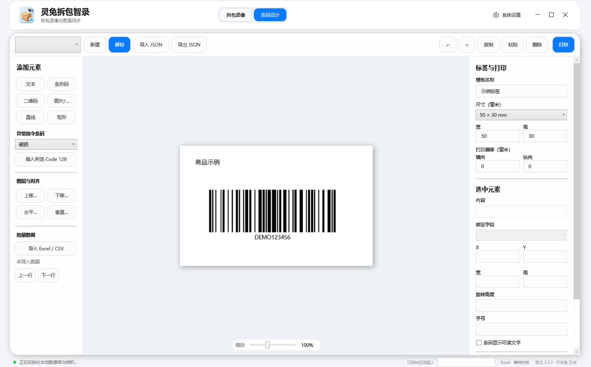

# 灵兔拆包智录

**简体中文** | [English](README.en.md)

  

**面向电商商家的 AI 辅助物流溯源与拆包取证软件。**

围绕“单号—包裹—录像—异常记录”，留存拆包、退货验货和打包发货过程。遇到少件、错发、破损或售后争议，可按单号找回对应录像、照片与备注，核对包裹处理过程。

- **物流溯源**：按单号、日期和异常标签查找包裹记录，回放对应处理过程。
- **过程取证**：扫码录像、拍照留存、异常标记，配合 Excel / WPS 整理记录。
- **AI 协同**：通过 MCP / CLI 让智能体查询记录、整理备注标签、重试同步；当前源码已支持，公开 v2.6.3 安装包尚未包含。

官网：[record.lttlt.top](https://record.lttlt.top) · [品牌升级与数据保留](docs/operations/brand-upgrade.md) · [2.6.3 预发布说明](docs/releases/2.6.3.md)

> 当前 **2.6.3 属于预发布（Prerelease）**，Windows 安装器尚未取得代码签名，首次运行可能出现 SmartScreen 提示。

**快速导航**：[界面与功能](#软件界面与核心功能) · [下载安装](#下载与安装) · [四步开始](#四步快速开始) · [详细教程](docs/user-guide.md) · [常见问题](docs/user-guide.md#20-常见问题) · [许可证](#详细教程隐私与许可)

## 灵兔电商 AI 溯源套件

采购来源整理 → 包裹过程留证 → 售后核对与 AI 接待。三款软件各有分工，可按业务搭配使用。

| Logo | 项目与用途 |
| :---: | :--- |
|  | **[本项目：灵兔拆包智录](https://github.com/907609732/lingtu-recorder)** 物流溯源与过程取证：按单号查拆包/打包录像、照片和异常备注。 |
|  | **[电商平台采购订单导出](https://github.com/907609732/lingtu-order-export)** 采购溯源：整理买家订单、商品明细与物流信息，导出 Excel/CSV。 |
|  | **[灵兔 AI 电商客服](https://github.com/907609732/LTTLT-AI-Customer-Service)** 售后协同：管理店铺与商品知识，辅助处理咨询和售后回复。 |

各应用独立安装、分别保存数据；可按单号核对采购与包裹记录，目前不自动互传订单、录像或客服数据。

## 软件界面与核心功能

> 图片来自 2.6.3 界面的隔离渲染；记录和标签为示例，未连接相机。

### 1. 扫码拆包 / 打包录像

- 选择摄像头和“拆包 / 打包”模式，扫描单号开始录像；再扫同一单号结束，扫描新单号自动切换。
- 在画面下方拍照、旋转、镜像或全屏预览；录像时还可以标记异常、添加备注。
- 扫码枪不可用时，可在右下角手动输入单号。

### 2. 最近记录、查找与回放

- 点击主界面右侧“查看全部记录”，按单号、备注、日期或异常标签查找。
- 找到记录后可播放、打开文件夹、查看照片或导出；Excel 同步结果以记录的状态列为准。

### 3. 条码设计与打印

- 点击顶部“条码设计”，添加文字、条形码、二维码或图片，调整标签尺寸后打印。
- 可以导入 Excel / CSV 批量制作标签；打印前建议先试打一张。

## 更多功能

- **Excel / WPS 同步**：在“系统设置 → 存储与数据”选择或生成工作簿；文件被占用时会等待并重试。
- **手机协同**：安卓手机可作为扫码器或摄像头。手机和电脑连接同一局域网后，在“系统设置 → 手机协同”扫码配对。
- **本机智能体接口（源码开发分支）**：MCP + CLI 可查询记录与标签、设置备注、添加/移除标签和重试 Excel 队列。仅本机 stdio/回环，不控制录像；已发布 2.6.3 尚未包含。见[接入说明](docs/agent/README.md)。

## 下载与安装

- [Windows 安装器 v2.6.3](https://github.com/907609732/lingtu-recorder/releases/download/v2.6.3/EcommerceUnpackRecorder-win-Setup.exe)
- [安卓 APK v2.6.3](https://github.com/907609732/lingtu-recorder/releases/download/v2.6.3/EcommerceUnpackRecorder-Android.apk)
- [全部发布与版本说明](https://github.com/907609732/lingtu-recorder/releases)

安装版无需 .NET SDK。发布页提供 SHA256 校验值。

## 四步快速开始

1. 下载并安装 Windows 版，启动后阅读用户协议与隐私政策。
2. 按向导选择录像目录；Excel 可以暂时跳过。若发现旧数据，“合并”默认勾选，请先核对。
3. 在“系统设置 → 相机信息”选择并测试摄像头，建议先使用单机位。
4. 回到主界面扫描单号开始录像，完成后在右侧查看记录。

可选匿名统计默认勾选，不需要时可取消，或稍后在“系统设置 → 关于”关闭。

## 详细教程、隐私与许可

本项目不修改 HIK SCAN，也不包含海康的源代码、商标或专有资源。

- [用户教程（中文）](docs/user-guide.md)：扫码、相机、手机配对、条码设计、迁移、卸载与故障排查。
- [本机智能体 MCP + CLI 接入](docs/agent/README.md)：源码开发分支的 8 个工具、JSON 输出、退出码与范围限制。
- [隐私政策](docs/PRIVACY.md) · [用户协议](docs/TERMS.md) · [安全与漏洞报告](SECURITY.md)
- [MIT 许可证](LICENSE) · [第三方组件与许可证](THIRD_PARTY_NOTICES.md)

---

**简体中文** | [English](README.en.md) · [用户教程](docs/user-guide.md)
