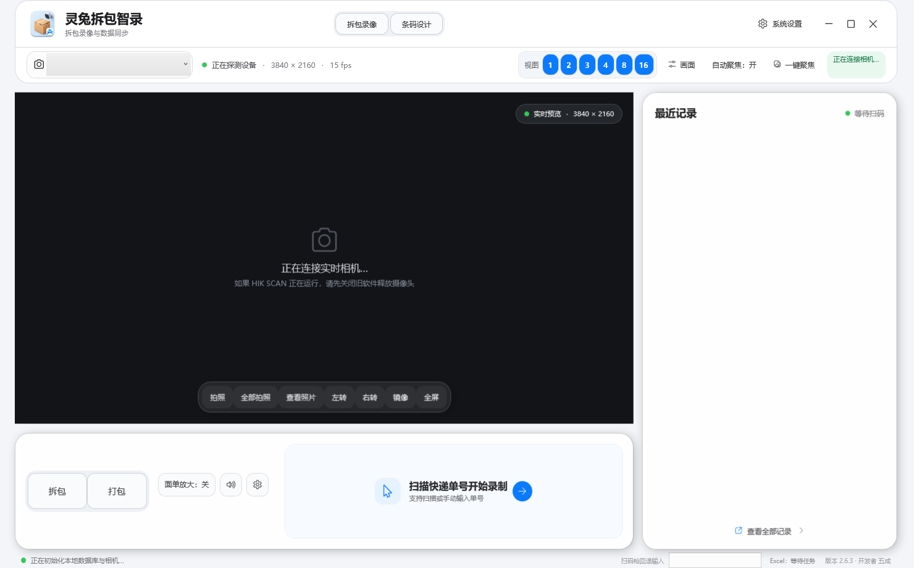
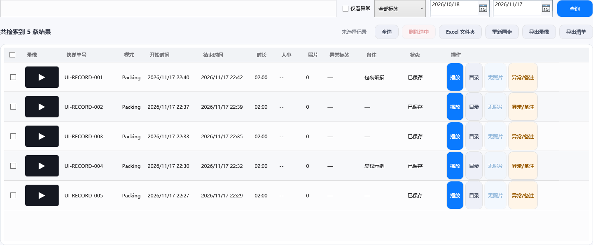
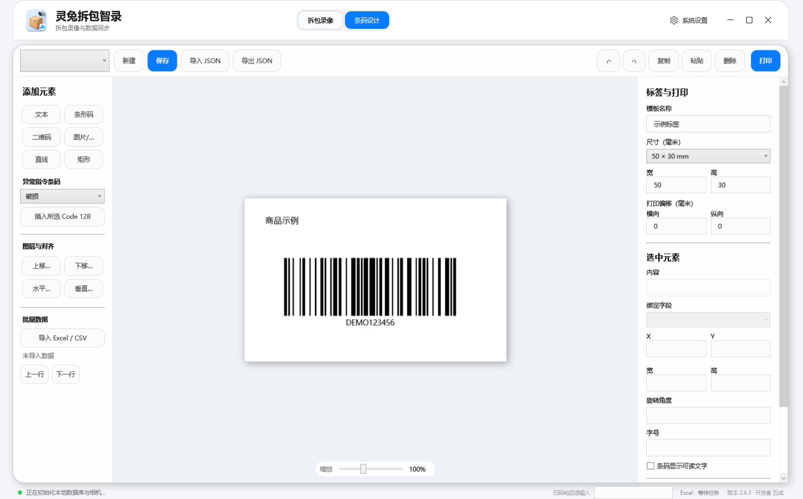

# Lingtu Unpack Recorder User Guide (2.6.3 prerelease)

This guide is for ordinary users of the Windows release build. It follows the real order of work: download, first run, scanning, data, phone, labels, migration, and uninstall. **You do not need the .NET SDK and you do not need to build anything to use the installed app.**

- Version: **2.6.3 prerelease**
- System: Windows 10 / 11
- Interface language: **Simplified Chinese**. Menu names are shown in Chinese with an English explanation because the desktop and Android UI are currently Chinese only.
- 中文版：[中文使用教程](user-guide.md)
- Back to: [README (English)](../README.en.md)

## Contents

1. [Before you start: safety and data](#1-before-you-start-safety-and-data)
2. [Download and verify](#2-download-and-verify)
3. [Install the Windows app](#3-install-the-windows-app)
4. [First launch: terms and privacy](#4-first-launch-terms-and-privacy)
5. [First-run wizard: recording folder, Excel, recovery](#5-first-run-wizard-recording-folder-excel-recovery)
6. [Camera setup and camera test](#6-camera-setup-and-camera-test)
7. [Recording folder and optional Excel](#7-recording-folder-and-optional-excel)
8. [Scan to start, finish, and switch parcels](#8-scan-to-start-finish-and-switch-parcels)
9. [Exceptions, notes, and snapshots](#9-exceptions-notes-and-snapshots)
10. [History search, playback, and sync status](#10-history-search-playback-and-sync-status)
11. [Excel sync failures and manual retry](#11-excel-sync-failures-and-manual-retry)
12. [Pairing a phone](#12-pairing-a-phone)
13. [Phone scanner, smart camera, and exception controls](#13-phone-scanner-smart-camera-and-exception-controls)
14. [Thermal label designer](#14-thermal-label-designer)
15. [HIK SCAN compatible sync](#15-hik-scan-compatible-sync)
16. [Single camera first, and multi-camera prerelease limits](#16-single-camera-first-and-multi-camera-prerelease-limits)
17. [Backup, recovery, and migration](#17-backup-recovery-and-migration)
18. [Updating](#18-updating)
19. [Safe uninstall](#19-safe-uninstall)
20. [FAQ](#20-faq)
21. [Acceptance boundaries](#21-acceptance-boundaries)

---

## 1. Before you start: safety and data

1. **Back up business data first.** Before trialling, upgrading, changing the recording folder, or moving to a new computer, copy the existing recording folder, Excel workbook, and label templates to another disk or an external drive.
2. **Use sample data while learning.** Invent example tracking numbers, an example workbook, and example labels. Never put real customer tracking numbers, workbook paths, or pairing data into screenshots, guides, issues, or chat.
3. **Never publish the pairing QR code.** The QR code shown on the computer is a one-time login credential valid for five minutes. Do not screenshot it into a group chat or the internet.
4. **Do not delete business data casually.** "删除选中" (delete selected) in history and "永久删除" (permanent delete) during uninstall can remove recording files. Confirm your backup first.
5. **2.6.3 is a prerelease.** The Windows installer has no trusted code signature and is published as a prerelease. Physical camera, barcode scanner, phone pairing, and long-run recording acceptance results are those recorded for that release; this guide does not replace on-site acceptance.
6. **Start with one camera.** Get the single-camera workflow stable before adding cameras.

---

## 2. Download and verify

1. Open <https://github.com/907609732/lingtu-recorder/releases> and select **v2.6.3**.
2. Under Assets, download `EcommerceUnpackRecorder-win-Setup.exe`:
   <https://github.com/907609732/lingtu-recorder/releases/download/v2.6.3/EcommerceUnpackRecorder-win-Setup.exe>
3. If you also need the phone companion, download `EcommerceUnpackRecorder-Android.apk`:
   <https://github.com/907609732/lingtu-recorder/releases/download/v2.6.3/EcommerceUnpackRecorder-Android.apk>
4. Find the **SHA256** published for that release. If the release also ships `SHA256SUMS.txt`, place it next to the installer.
5. In the folder containing the installer, open PowerShell and compare the hash exactly (case-insensitive):

```powershell
Get-FileHash -Algorithm SHA256 -LiteralPath .\EcommerceUnpackRecorder-win-Setup.exe
```

6. If the hash does not match the published value, **do not install**. Delete the file, download again, and stop using the file if it still mismatches.
7. The current installer is unsigned, so `Get-AuthenticodeSignature` reporting no signature is expected and is not, by itself, proof the file is safe. Trust only a matching combination of download source, published SHA256, and version number.
8. The website (record.lttlt.top) does not host large files; installers come from GitHub Releases only.

> Note: do not download installers from third-party cloud drives, chat attachments, or re-packaging sites, and do not disable Windows security features to skip SmartScreen.

---

## 3. Install the Windows app

1. Double-click `EcommerceUnpackRecorder-win-Setup.exe`.
2. Complete the **per-user** Velopack installation. Installed builds need **no** .NET SDK, Visual Studio, or Android Studio.
3. If SmartScreen appears, confirm the file name, version, and source match the release page before continuing.
4. Launch 灵兔拆包智录 from the Start menu.
5. Later updates download in the background and install only when recording is idle and you confirm them (see section 18).
6. Finish any active recording and exit the app before an in-place upgrade. Upgrades normally keep existing business data, but take a backup first.

---

## 4. First launch: terms and privacy

1. The first launch shows the window "首次使用前，请了解本地数据、相机和更新行为" (local data, camera, and update behaviour).
2. Read **查看用户协议** (terms) and **查看隐私政策** (privacy policy).
3. Confirm you understand that tracking numbers, recordings, notes, and Excel stay on this computer by default, and that optional anonymous daily activity sends only a daily anonymous value, platform, and version.
4. **帮助作者统计匿名日活（可选，可随时关闭） is checked by default**; clear it here if you do not want it. It can also be turned off later in settings, and clearing it changes no functionality. This guide describes the UI and source behaviour and does not claim that network traffic or statistics delivery has been measured.
5. Tick **我已阅读并同意《用户协议》和《隐私政策》** and click **同意并继续**.
6. **不同意并退出** closes the app before any camera or network access.
7. Camera permission is requested only when you actually enter scanning or recording, and the current version does not request microphone permission.

---

## 5. First-run wizard: recording folder, Excel, recovery

The wizard has five steps: **1 欢迎 (welcome) → 2 录像目录 (recording folder) → 3 Excel 表格 (workbook) → 4 恢复检查 (recovery check) → 5 完成 (finish)**. The bottom buttons are **上一步**, **退出**, and **下一步**; on the last step the "next" button becomes **进入软件**.

1. **Step 1 – welcome.** Read "业务数据由你自己保管". A hidden `.unpackvision` portable index is created inside the recording folder so you can recover records after reinstalling or changing computers.
2. **Step 2 – recording folder.** Click **选择目录**, choose a folder on a disk with plenty of free space and a backup routine, then click **检查目录** to confirm it is writable and large enough.
3. **Step 3 – Excel.** Pick one:
   - **选择现有表格** — bind an existing workbook;
   - **生成新表格** — create the standard six-column workbook;
   - **暂时跳过** — recording still works; you can add Excel later.
4. **Step 4 – recovery check.** Review "历史数据扫描结果". When recoverable records are found, **完成配置时将可恢复记录合并到本机数据库 is checked by default**; review the preview counts, and clear the checkbox first if you do not want the merge. Note that **clicking 下一步 on this step performs the merge immediately** — there is no second confirmation dialog. Tags and exception times that cannot be determined are reported as partial recovery, not invented.
5. **Step 5 – finish.** "配置已准备好" summarizes the folder and workbook; click **进入软件**.
6. Later path changes are made in **系统设置 → 存储与数据** (settings → storage and data) and **only take effect after clicking 保存设置**.

> Note: Excel can be added at any time; choose the recording folder carefully once. Avoid moving it around after that, and use the migration flow in section 17 instead.

---

## 6. Camera setup and camera test

### 6.1 Choose the recording mode

1. Open **系统设置** (the gear icon at the top right, or the gear next to the mode buttons).
2. Switch to the **相机信息** tab.
3. Under "1 选择录像模式" select **单机位** (single camera). This is the right start for normal unpacking.
4. Select **多机位（最多16路）** only when you need several angles; the page notes that single-camera mode uses only the primary camera.
5. Tick **同时生成多机位合成视频（5路以上默认关闭）** only if you need a composite; leave it off at first.

### 6.2 Select and configure a camera

1. In "机位列表" double-click a camera slot, or select it and click **配置选中机位**.
2. In the "配置机位" dialog, set **机位名称** and choose **来源类型**:
   - **自动选择本地摄像头** — pick any eligible local camera automatically;
   - **指定 Windows 摄像头（USB / iVCam）** — choose a specific device from "选择本地摄像头";
   - **IPC / 自定义 RTSP、HTTP 视频流** — enter a full stream URL; credentials are encrypted with Windows DPAPI;
   - **海康威视 NVR / DVR** — enter recorder address, port, channel, and main/sub stream; **发现并添加全部通道** can import channels.
3. Click **开始预览** and confirm orientation, resolution, and frame rate. Expand "高级录像与画面参数" if you need to adjust resolution, frame rate, brightness, or mirroring.
4. Click **保存机位**. Cancel discards the change.
5. **扫描局域网 IPC** can discover LAN cameras, but "discovery succeeded" is not stream validation: confirm a live picture in the preview before saving.

### 6.3 Test and save

1. Return to "2 测试并保存" in the **相机信息** tab.
2. Click **测试当前机位** (enough for single camera), or **测试全部机位** for multi-camera.
3. Review the reported resolution, frame rate, estimated bitrate, hourly size, and recordable hours. Re-test after any multi-camera change.
4. Click **保存设置** at the bottom right. Nothing is applied before saving.

### 6.4 Everyday adjustments on the main window

- The drop-down at the top left switches between **自动模式** and a specific local camera index.
- **自动聚焦：开** and **一键聚焦** help with focus; the **画面** button opens "画面参数" (brightness, contrast, sharpness, saturation, restore defaults).
- Buttons under the preview: **拍照** (snapshot), **全部拍照** (snapshot all), **查看照片** (view photos), **左转** / **右转** (rotate), **镜像** (mirror), **全屏** (full screen).
- Confirm the video source and picture before starting a recording. End the current recording before changing sources on site.

> Note: the standalone recorder needs exclusive camera access. If the preview stays on "正在连接实时相机…", close HIK SCAN or any other monitoring software first.

---

## 7. Recording folder and optional Excel

1. Open **系统设置 → 存储与数据**.
2. **主录像位置** (main recording location): click **选择** to change it. On save the app counts finished recordings and the `.unpackvision` index in the old folder and asks whether to migrate (see section 17); this is a migration, not recovery, so back up first.
3. **Excel 工作簿**: **选择** binds an existing workbook and only checks exclusive read/write access, lock state, and headers — it writes no test row. `.xlsx` only; the worksheet must be `退货扫码单号`; the first six headers must be `扫码日期`, `快递单号`, `关联结果`, `金额`, `备注`, `图片凭证`. **生成** creates the standard six-column workbook, including a frozen header row, auto-filter, and a hidden sync-marker worksheet.
4. **工作区状态** shows whether setup is complete and whether the folder is usable, with the reason when it is not.
5. **录像盘位** (recording disks): click **管理录像盘位** to add disks, move them up or down, enable or disable them, remove a slot, or click **检查全部**. Removing a slot deletes configuration only, never recordings.
6. All videos of one parcel stay on the same disk; when space runs low, the next parcel switches to the next healthy disk.
7. Click **保存设置** to apply.
8. The "数据检查与恢复" area offers **检查旧数据** (scan old data), **重建本机数据库** (rebuild local database), and **查看恢复报告** (view recovery report); see section 17.

> Note: a locked workbook is never force-written. The task stays in the SQLite queue and retries automatically after the workbook is closed.

---

## 8. Scan to start, finish, and switch parcels



*Isolated interface render; no camera was connected.*

### 8.1 The three everyday actions

1. Confirm the mode at the bottom of the main window: **拆包** (unpacking) or **打包** (packing). The mode selects the `Unpacking` or `Packing` subfolder.
2. Scan a normal parcel tracking number. Recording starts immediately, the time and tracking number are burned into the picture, and "最近记录" shows 录制中.
3. Finish in one of two ways:
   - **Scan the same number again** — the encoder closes safely, the MP4 is saved, and the record enters the sync queue;
   - **Scan a new number** — the current recording is saved and the next one starts automatically.
4. If the scanner fails, click **结束录像** (end recording) in the active-recording panel. Do not force-close the app while a recording is being saved.

### 8.2 Manual input and scanner fallback

- The **扫码枪回退输入** box at the bottom right of the main window accepts a typed or pasted tracking number when the scanner is unavailable.
- The centre panel **扫描快递单号开始录制** notes that scanning or manual entry both work.

### 8.3 Tracking-number rules

Open **系统设置 → 单号配置**:

1. **单号长度** — minimum and maximum length; content outside the range never starts a recording.
2. **过滤开头** / **过滤结尾** — strip fixed prefixes or suffixes added by the scanner.
3. **防误扫间隔（毫秒）** — ignore repeated identical input within the interval.
4. Click **保存设置**.

### 8.4 Duration and voice

Open **系统设置 → 存储与数据 → 启动与语音**:

1. **最长录像** in minutes: when the limit is reached the app asks whether to **继续录像** (continue, restarting the timer) or **停止并保存** (stop and save). The default is 5 minutes; it does not stop silently.
2. **启动后立即显示实时相机** and **启用开始、停止和异常语音播报** can be toggled per site.
3. Drag **播报音量** and use **试听** to check it.

> Note: tracking numbers are stored as text, so letters, hyphens, and leading zeroes are preserved. A repeated number is marked 重复 in the recent-records list.

---

## 9. Exceptions, notes, and snapshots

### 9.1 Configure exception tags

Open **系统设置 → 异常标签**:

1. The grid lets you toggle **启用**, edit **名称** and **颜色**; **固定条码内容** is read-only and does not change when a tag is renamed or recoloured.
2. **新增标签** adds a custom tag; **删除选中** removes one.
3. Default tags include 破损 (damaged) and 调包 (substituted). **固定撤销条码：UV-UNDO-TAG** undoes the most recent tag.
4. Tick **扫描异常标签时自动截取当前画面（首次默认关闭）** to capture the current frame when a tag is added.
5. Click **保存设置**.

### 9.2 Add exceptions and notes while recording

1. During a recording, click the **破损**, **调包** buttons in the active-recording panel, or scan the matching command barcode. Command barcodes take priority over normal tracking numbers.
2. One parcel can carry several tags; the status line shows "当前没有异常标签" or a tag summary.
3. A wrong tag can be undone with **撤销标签** on the active-recording panel (it undoes only the most recent active tag); do not wait until the recording ends.
4. Type the note in the note box; it autosaves about 500 ms after you stop typing, with no extra button.
5. Click **结束录像** to finish immediately.
6. Exceptions flow into the live watermark, the recording file name, the local database, history search, and column E of the workbook. **Notes typed by hand in Excel are never overwritten.**
7. To review parcel photos, click the photo-count button in "最近记录".

> Note: exception tags change the recording file name and the Excel content. Undo a wrong tag immediately instead of editing the database afterwards.

---

## 10. History search, playback, and sync status



*The records shown are examples.*

1. At the bottom of "最近记录", click **查看全部记录** to open the "全部记录" window.
2. Filters at the top:
   - the search box matches **tracking number or note**;
   - tick **仅看异常**;
   - pick an exception tag;
   - pick start and end dates;
   - click **查询**.
3. Columns: thumbnail, tracking number, mode, start time, end time, duration, size, photos, exception tags, note, status, actions.
4. The **状态** column shows real states such as **Excel 已同步**, **Excel 同步中**, **Excel 同步失败**, **Excel 等待同步**, **HIK 历史基线**, **已保存**, **异常**, **录制中**.
5. Row actions:
   - **播放** opens the player;
   - **目录** opens the recording folder in Explorer;
   - **照片** opens the exception snapshots;
   - **异常/备注** edits tags and notes.
6. In the player:
   - multi-camera recordings show **同步画面** on the left and keep the current position when switching angles;
   - **暂停**, a progress bar, and 0.5× / 1.0× / 1.5× / 2.0× speeds;
   - clicking an exception timestamp jumps straight to that frame.
7. Toolbar actions: **加载更多**, **全选**, **删除选中**, **Excel 文件夹**, **重新同步**, **导出录像**, **导出清单** (CSV). **重新同步** resets and re-queues every Excel task that has **not succeeded yet — pending, failed, and processing** — for the Excel connector (`RetryConnectorAsync("excel")`, `connector_id` match and `status <> 'Succeeded'`); it is unrelated to the current selection and needs no selected rows.
8. Select several rows with Ctrl or a range with Shift.
9. Date filters use the scan time and default to the last 30 days; about 100 rows load at a time, and **加载更多** continues.

> Note: deleting a history record does not remove rows already written to Excel. Rows that are still recording or saving are refused with a message. Confirm your backup before deleting files.

> About sync status: the green **已同步** label on the main-window "最近记录" card is a fixed caption and does not prove the row reached Excel. Use the **状态** column in "全部记录" or the sync messages instead.

---

## 11. Excel sync failures and manual retry

1. After a recording is saved, the number, date, associated result, and exception notes enter a reliable sync queue. The status bar shows messages such as `Excel：等待任务` or `Excel：本轮处理 N 条`.
2. Write rules (no manual work needed): append after the last real non-empty cell in column B; a real date in A; tracking number forced to text in B; blanks in D and F; the compatibility marker `【拆包智录】` plus exceptions and notes in E. **Column C receives the platform-association formula only when the workbook also contains the three legacy Pinduoduo, Taobao, and JD association sheets; otherwise C stays blank**, which is normal for a standard six-column workbook.
3. A recovery copy is created before each write, by default in `%LOCALAPPDATA%\UnpackVision\Backups`, then saved via a temporary file and atomic replacement.
4. If the status stays **Excel 等待同步**:
   1. close Excel, WPS, or the business system holding the workbook;
   2. make sure the workbook is not read-only and not locked by a sync client;
   3. in "全部记录" click **重新同步** directly; it resets and re-queues every Excel task that has **not succeeded yet (pending, failed, processing)** for the Excel connector, and neither requires nor limits itself to the selected rows;
   4. the message "失败或等待中的 Excel 同步任务已重新排队" is only the dialog wording; the actual scope includes processing tasks, and the queue resumes automatically.
5. Click **Excel 文件夹** to open the workbook's folder and confirm which file is used.
6. The queue lives in SQLite, so pending tasks survive an app restart.

> Note: never let several automatic writers share one workbook. For the first trial, copy the workbook and select the copy in 系统设置 → 存储与数据; in normal production mode the compatibility service follows desktop settings, so `Excel__WorkbookPath` does not override it.

---

## 12. Pairing a phone

### 12.1 Prepare

1. Connect the computer and phone to the **same private LAN** (same router or the same phone hotspot). Never port-forward the station to the internet.
2. Make sure the desktop app is running and the station service is online.
3. Install the matching `EcommerceUnpackRecorder-Android.apk` on the phone.

### 12.2 Generate the QR code on the computer

1. Open **系统设置 → 手机协同**.
2. Click **显示手机配对二维码** to open the "配对安卓手机" window.
3. **Inside that window**, pick the phone's network under **局域网地址（手机和电脑须在同一网段）**; on a multi-NIC computer choose the address on the phone's subnet.
4. The window shows "工位主机已就绪，请用手机扫描二维码". If the address was wrong or the code expired, correct the address and click **刷新二维码**.
5. The QR code is **valid for five minutes and can be used once**. Do not screenshot or share it.

### 12.3 Scan it on the phone

1. Open the Android app and tap **连接** (or **重新配对** if it was paired before).
2. On the "配对电脑" page tap **允许使用摄像头** and point the camera at the QR code.
3. Success shows "配对成功" with the station ID plus Chinese voice and vibration feedback.
4. "工位服务在线，但电脑录像程序未打开" means the station service is up but the desktop app is not; start it and retry.

### 12.4 Manage devices

1. In **系统设置 → 手机协同** click **管理已配对设备**.
2. The list shows device name, status, roles, permissions, pairing time, and last-seen time.
3. Select a device and click **删除选中设备**. That phone immediately loses all permissions and must pair again.
4. Remove phones you no longer use, especially lost or handed-over devices.

> Note: every phone has its own key, the station token is protected by Android Keystore, and the computer stores only token hashes. After moving to a new computer or restoring a workspace, business records come back but phones must pair again.

---

## 13. Phone scanner, smart camera, and exception controls

The phone home page renders only two entry cards under "选择工作方式": **手机扫码器** and **智能摄像头** (above them is the connection card, and "设置" sits at the top right). The source defines more work modes, but the UI does not expose them as home entries:

- "collect numbers only" is the **手机扫码器** state when **更多设置 → 启动电脑录像** is switched off;
- exception controls (tags, note, snapshot, stop) are embedded at the bottom of the **手机扫码器** screen, not a separate page.

### 13.1 Phone scanner

1. Choose **手机扫码器** ("full-screen scanning, optionally start computer recording").
2. Confirm the header shows "电脑已连接"; reconnect from the home page first if it does not.
3. Expand **更多设置 ▼** and toggle **启动电脑录像**:
   - on — "扫码将开始、结束或切换电脑录像";
   - off — "仅收集单号并同步 Excel", the collect-numbers-only branch: the scan is first queued on the phone, then submitted to the computer and queued for Excel.
4. Scan parcel barcodes; the computer decides whether to start, finish, or switch recordings. After desktop confirmation the phone reports "单号已收集" and similar messages.
5. On a flaky network the phone shows **已离线保存，联网后自动补发** with a **待同步 N** counter, and resends automatically when connectivity returns or you scan again.
6. **闪光灯** helps in dim light.

### 13.2 Exception controls (inside the phone scanner screen)

1. The bottom panel shows "电脑已连接/未连接" and "正在录像：<number>" or "电脑空闲"; tap **刷新状态** to re-read.
2. Available actions:
   - **破损**, **调包**, **少件**, **采购** add a tag to the active recording;
   - **问题备注** followed by **保存**; the field accepts up to 2000 characters and the desktop rejects longer notes;
   - **截图** captures the current frame;
   - **停止** ends and saves the recording.
3. **The phone UI currently has no visible undo button.** If a tag is wrong, click **撤销标签** on the desktop recording panel, or scan the fixed `UV-UNDO-TAG` barcode with a scanner.
4. Every exception command requires the computer to be actively recording; commands sent while idle or saving are rejected.
5. The phone confirms with Chinese voice and vibration feedback after the desktop acknowledges.

### 13.3 Smart camera

1. Choose **智能摄像头** ("use the phone as a computer camera and detect tracking numbers").
2. The status should read "电脑已连接 · 等待扫码"; before the first stream it may read "视频服务已就绪，点击开始推流".
3. Tap **开始推流** to publish RTSPS video to the computer. **Scans are rejected until streaming starts** ("请先开始推流，再扫描快递单号"). Tap **停止推流** to stop.
4. Tap **切换镜头** to switch cameras; enable **闪光灯** in "更多设置" in low light.
5. The overlay shows the last detected number and the upload bitrate.
6. A code must be seen **twice inside a 300 ms stability window** before it is sent, and the same code cannot retrigger until it has left the scan area for **1.2 s**.

> Note: the phone UI is Chinese and has no history page; search and playback stay on Windows. Plaintext LAN traffic is allowed only on the development `127.0.0.1` reverse channel; never disable certificate validation or switch to a plaintext LAN address in production.

---

## 14. Thermal label designer



*The label shown is an example.*

1. Click **条码设计** at the top of the main window. **Recording continues**; switch back to **拆包录像** at any time.
2. Toolbar: **新建**, **保存**, **导入 JSON**, **导出 JSON**, undo ↶, redo ↷, **复制**, **粘贴**, **删除**, **打印**.
3. Left panel "添加元素": **文本**, **条形码** (Code 128), **二维码**, **图片/Logo**, **直线**, **矩形**.
4. "异常指令条码" lets you pick an exception tag and click **插入所选 Code 128**, so the damage/substitution command barcode is printed on the label and can be scanned on site.
5. "图层与对齐": **上移一层**, **下移一层**, **水平居中**, **垂直居中**.
6. "批量数据":
   1. click **导入 Excel / CSV** and choose the data file;
   2. the status line reports the imported row count;
   3. use **上一行** / **下一行** to preview records;
   4. pick the mapped column in **绑定字段** under "选中元素".
7. Right panel "标签与打印":
   - **模板名称**;
   - **尺寸（毫米）**: 50 × 30 mm, 60 × 40 mm, or **自定义**;
   - **打印偏移（毫米）**: horizontal and vertical nudges;
   - **打印范围**: start row / end row (blank means all);
   - **每行份数**.
8. "选中元素" edits **内容**, **绑定字段**, X/Y, width/height, **旋转角度**, **字号**, and the **条码显示可读文字** option. Elements can be dragged, resized, rotated, copied, and pasted.
9. Click **保存** to store the template in `%LOCALAPPDATA%\UnpackVision\Templates`, and **打印** to print through an installed Windows printer driver.

> Note: the designer prints through installed Windows printer drivers; set media, density, and vendor-specific options in the driver. Print on plain paper first to calibrate offsets, then switch to thermal stock; validate with 2–3 sample rows before a batch.

---

## 15. HIK SCAN compatible sync

Two different "Hikvision" capabilities must not be confused:

- **This section**: HIK SCAN recording-file compatibility, a read-only watcher over MP4 folders that HIK SCAN produces, parsed into the database and Excel.
- **Camera source**: 系统设置 → 相机信息 → 配置选中机位 → 来源类型 → 海康威视 NVR / DVR uses recorder channels as camera input. It does not use the compatibility service or a HIK SCAN folder.

Order of work:

1. Identify the unpacking and packing folders to watch (HIK SCAN paths such as `LogisticsUnpacking` and `LogisticsPaking`). The service scans only top-level `*.mp4` files in those two folders and does not recurse into subfolders.
2. **The Excel path comes from the desktop settings.** In normal production mode the service loads the desktop `settings.json` at startup and overwrites the service-configured recording folder and Excel path, so the `Excel__WorkbookPath` environment variable normally has no effect. Select the workbook in the desktop app under 系统设置 → 存储与数据 first.
3. The HIK folders themselves can still be overridden by environment variables, because desktop settings do not replace them:

```powershell
$env:HikCompatibility__UnpackingDirectory = 'D:\HIK SCAN\storage\LogisticsUnpacking'
$env:HikCompatibility__PackingDirectory = 'D:\HIK SCAN\storage\LogisticsPaking'
powershell -ExecutionPolicy Bypass -File .\scripts\run-service.ps1
```

4. Environment overrides for the recording folder and Excel path apply only to an isolated test instance started with `UNPACKVISION_ALLOW_TEST_INSTANCE=1`; that switch must never point at real business data.
5. The service waits until an MP4 is stable, can be opened, and yields a first frame, then parses the tracking number and start/end times, stores the record in SQLite, and syncs Excel through the reliable retry queue. File names must follow `单号_14位开始时间_14位结束时间.mp4`.
6. The **first run only indexes existing recordings and does not backfill Excel**; only new recordings enter the sync queue. Those historical rows show the status **HIK 历史基线**.
7. To use the local API, read the key first:

```powershell
powershell -ExecutionPolicy Bypass -File .\scripts\run-service.ps1 -ShowApiKey
```

8. Except for `/api/v1/health`, requests must send `X-UnpackVision-Key: <local API key>`.
9. In 2.6.3 the compatibility service binds loopback only and validates connection and Host headers. Never expose the port to the LAN or the internet.

> Note: the compatibility service can run alongside HIK SCAN because it only reads recordings. The standalone desktop recorder needs exclusive camera access, so exit HIK SCAN when recording with it. **How an installed release starts this service is not verified**: the release scripts only publish `UnpackVision.Service` into the `Service` subdirectory under the staging root `App`, and where it ends up after installation and how it is started are not verified; the repository contains no implementation record of the desktop app launching it or registering it as startup — do not assume opening the desktop app synchronizes HIK folders. From source, start it with `scripts\run-service.ps1` and watch the logs. `Start-Sync-Service.cmd` in the repository root hardcodes `artifacts\publish\staging\2.3.0` and works only for that staging output, not as a universal launcher for every release.

---

## 16. Single camera first, and multi-camera prerelease limits

### 16.1 Recommended path

1. Complete the whole loop with **单机位**: preview → scan recording → exception notes → history playback → Excel sync.
2. Only then switch to **多机位（最多16路）** in **系统设置 → 相机信息**, add cameras one at a time, and designate a primary camera.
3. After any change to cameras, composite options, or disks, run **测试全部机位** again before saving.

### 16.2 Prerelease limits (still valid in 2.6.3)

- Up to 16 USB, virtual, phone, IPC, or Hikvision recorder channels can be configured. The number a computer can actually sustain must be proven by end-to-end performance testing.
- 1–4 cameras save individual streams plus a 1080p composite by default; 5–16 cameras disable the composite by default to protect individual streams.
- The primary camera is mandatory. Writer failure or five seconds without a frame ends the session safely. Secondary cameras reconnect automatically and leave auditable media gaps; they are never reported as complete.
- A 60-second result for 5–16 cameras is tied to the current cameras, composite option, and all enabled disks; retest after any change.
- History playback is limited to four synchronized views by default; 8/16-view playback waits for later performance acceptance.
- Disk removal, drive-letter changes, and capacity warnings still need physical acceptance.
- This repository does not record the two-hour 8/16-camera test, 100-parcel run, or disk-failover acceptance.

> Note: these are current capability boundaries, not minor known issues. Run a small pilot before scaling to your real volume.

---

## 17. Backup, recovery, and migration

### 17.1 What to back up together

1. The **entire recording folder**, including the hidden `.unpackvision` (numbers, times, relative paths, tags, exception times, notes, sync state).
2. The **Excel workbook**.
3. `%LOCALAPPDATA%\UnpackVision\unpackvision.db` and `settings.json` beside it.
4. `%LOCALAPPDATA%\UnpackVision\Templates`.

Copying only MP4 files still allows **partial** recovery for recordings that follow this app's naming rule: tracking number, start/end times, and tag names recorded in the filename's exception suffix. Recovered exception timestamps are placeholders and cannot locate the real events. Notes, real exception timestamps, and sync state cannot be reconstructed from file names and **may be lost**. The portable index stores **no** camera passwords, phone tokens, or API keys.

### 17.2 Change the recording folder and migrate

1. Take a full backup first.
2. In **系统设置 → 存储与数据**, click **选择** next to **主录像位置**.
3. Click **保存设置**. The app counts finished recordings and `.unpackvision` data in the old folder and asks whether to migrate.
4. If you migrate, files are copied and verified one by one, the new location is committed atomically, and the app then tries to remove source files whose length and SHA-256 match its verification receipt.
5. A "正在安全迁移录像" progress window appears; do not close it or disconnect storage.
6. Missing, changed, or locked old files are not cleaned up; they are listed so you can retry.
7. Insufficient space, permissions, or conflicts block the switch.
8. The code only removes verified source copies, but power loss, hardware, or file-system faults cannot be ruled out, so **keep a separate full backup before migrating** instead of treating migration as a backup.

### 17.3 Move to a new computer

1. Install the same version on the new computer.
2. **On first launch**: choose the original recording folder in wizard step 2 and the original Excel in step 3; step 4 shows the "历史数据扫描结果" recovery preview. When recoverable records exist the merge option is **checked by default**: click **下一步** to merge immediately, or clear the checkbox first and then click **下一步** if you do not want to merge.
3. **If the app is already configured**: open **系统设置 → 存储与数据**, reselect the original **主录像位置** and **Excel 工作簿**, then click **保存设置**. Saving the recording location first raises a **migration** prompt that moves files from the current folder to the newly selected one; it is not recovery. Confirm your backup before agreeing.
4. Restore records separately: under 数据检查与恢复 click **检查旧数据** to preview classification counts, then **重建本机数据库** and confirm; only then does the app back up the current database and merge records.
5. Reconfigure cameras and camera slots, then re-run the camera test.
6. Reissue the pairing QR code in **手机协同** and pair every phone again.

### 17.4 Old folders without a portable index

1. Keep a full separate backup of the recording folder and workbook first.
2. Open **系统设置 → 存储与数据 → 数据检查与恢复**.
3. Click **检查旧数据**: this is preview only and reports the counts for complete, file-name-only, Excel-matched, conflict, missing-video, and invalid entries. It does not merge, move, or rewrite recordings.
4. If the counts look right, click **重建本机数据库** and confirm. The dialog states that the current database is backed up first, merged by field update time, and that recordings are not deleted or overwritten.
5. Click **查看恢复报告** if you want a report on disk; it is for inspection only and never backfills Excel automatically.

> Note: migration is not a backup. Keep a full copy before every migration, and never move or rename files inside the recording folder while the app is running.

---

## 18. Updating

### 18.1 Windows

1. When the "发现新版本" banner appears, click **更新说明** to read the changes, then **重启并安装** or **稍后**.
2. You can also use **系统设置 → 关于**:
   - tick **自动检查并在后台下载更新**;
   - click **立即检查更新**;
   - when a version is available, click **重启并安装**, **查看最新版本**, or **下载 Windows 安装器**.
3. Finish and save any active recording first. Updates wait for recording to be idle and for your confirmation.
4. Updating normally keeps the database, settings, recordings, and Excel workbook, but any upgrade can go wrong; make a full backup first and verify the record list and workbook afterwards.

### 18.2 Android

1. Open the app's **设置 → 软件更新** and tap **立即检查**.
2. Tap **下载并校验更新** and wait for "下载及 SHA256 校验完成".
3. Tap **打开系统安装界面**; if Android asks to allow unknown apps, grant it and tap again.
4. Android requires an APK signed with the **same key**. Uninstalling and reinstalling loses pairing state and requires pairing again.

> Note: updates contact only the project website and GitHub and upload no tracking numbers, recordings, Excel files, or device data. Do not use update packages from unknown sources.

---

## 19. Safe uninstall

1. **Keep the app open.** End and save any active recording first (while recording, starting, or saving, safe uninstall reports "请先完成当前包裹"), then confirm the backup is usable.
2. Open **系统设置 → 关于 → 卸载与数据保留**.
3. Click **安全卸载灵兔拆包智录** to open the "安全卸载" window. Development or portable builds have no Velopack uninstaller, and the app then tells you to uninstall from Windows Settings → Apps instead.
4. Choose one:
   - **保留全部业务数据（推荐）** — removes only the program, shortcuts, and uninstall registration; keeps database, settings, pairing data, recordings, and Excel. Reinstalling continues where you left off.
   - **永久删除灵兔拆包智录的本机数据和录像** — shows two consecutive warnings and verifies `.unpackvision/workspace.json` against the current workspace ID; deletion is refused if verification fails.
5. Review "将要处理的位置", especially **Excel（始终保留）**.
6. Click **继续卸载**.
7. Permanent cleanup touches only `Unpacking`, `Packing`, `Snapshots`, `.unpackvision`, and `%LOCALAPPDATA%\UnpackVision`; Excel and all other files in the recording folder always remain.
8. Uninstalling from Windows Settings → Apps never obtains permission to delete business data, so everything is kept by default.

> Note: after permanent cleanup the recordings and portable index cannot be recovered from inside the app. Copy your backup to another disk before confirming.

---

## 20. FAQ

**Q1: Scanning a number does not start a recording.**
Check that the camera is available and not used by another app, verify the length and filter rules in 单号配置, then test with a sample number in the 扫码枪回退输入 box.

**Q2: The preview stays on "正在连接实时相机…".**
The camera is usually occupied. Exit HIK SCAN or other monitoring/conferencing software, re-plug the USB camera if needed, then retry **相机信息 → 测试当前机位**.

**Q3: The scanner types nothing, but the keyboard works.**
Raw Input is accepted per device. Re-plug the scanner and use the 扫码枪回退输入 box as a fallback; confirm the scanner is in keyboard-emulation mode.

**Q4: Excel stays on 等待同步 or 同步失败.**
Close Excel, WPS, or the business system holding the workbook and confirm it is not read-only; then click **重新同步** in 全部记录. It re-queues every Excel task that has **not succeeded yet (pending, failed, processing)**, so no row selection is needed (the dialog text mentions only failed or waiting tasks). The queue lives in SQLite and survives restarts.

**Q5: The phone says "工位服务在线，但电脑录像程序未打开".**
The station service is running but the desktop app is not. Start Lingtu Unpack Recorder and tap **刷新状态** on the phone.

**Q6: The pairing QR code expired.**
It is valid for five minutes and once only. Open **系统设置 → 手机协同** and click **刷新二维码**.

**Q7: I forgot the local API key.**
The key file is `%LOCALAPPDATA%\UnpackVision\api-key.protected`; never share it. When running the compatibility service from source, use `.\scripts\run-service.ps1 -ShowApiKey`.

**Q8: History is missing after changing computers.**
On first launch, wizard step 4 shows the recovery preview: when recoverable records exist the merge option is checked by default, and clicking **下一步** performs the merge; clear the checkbox first if you do not want it. If the app is already configured, open **系统设置 → 存储与数据 → 数据检查与恢复**, click **检查旧数据** to preview the counts, then **重建本机数据库** and confirm the merge. If you copied only MP4 files, partial recovery from file names may still work, but tags, notes, exception times, and sync state may be missing. Reselecting the recording folder and saving only raises a migration prompt, not recovery.

**Q9: Migration failed halfway — will old files be lost?**
Before deleting, the app re-reads both source and target and only removes a source file when its length and SHA-256 match the verification receipt. Missing, changed, or locked files are kept and listed. Power loss, hardware, and file-system faults cannot be ruled out, so keep a separate full backup and migrate again after resolving the conflict.

**Q10: Can recordings be recovered after permanent deletion?**
Not from inside the app. Restore them from your own backup — this is why a backup must be confirmed before uninstalling.

**Q11: Multi-camera recordings drop frames or have gaps.**
Reduce the number of cameras or disable the composite, re-run the 60-second test, and confirm every recording disk passes its write test. Gaps left by a disconnected secondary camera appear in the record and are not treated as complete.

**Q12: Where are the logs?**
`%LOCALAPPDATA%\UnpackVision\Logs`, rotated daily and at 20 MB, kept for up to 14 days; you can also click **打开日志目录** in **设置 → 关于**. Remove tracking numbers, paths, and other business details before sharing logs.

**Q13: The phone home page has no "exception remote" or "collect numbers only" entry.**
That is expected. The home page only shows 手机扫码器 and 智能摄像头: exception controls sit at the bottom of the phone scanner screen, and turning off 更多设置 → 启动电脑录像 switches the scanner to collect-numbers-only.

**Q14: The main window shows 已同步, but the row is not in Excel.**
The green 已同步 caption on the "最近记录" card is fixed UI text, not a sync result. Check the **状态** column in 全部记录 or verify the tracking number in column B of the workbook.

**Q15: Excel reports a header mismatch or a missing worksheet.**
The app requires `.xlsx`, the worksheet `退货扫码单号`, and the first six headers `扫码日期`, `快递单号`, `关联结果`, `金额`, `备注`, `图片凭证`. Use **生成** to create a standard workbook, or align the existing headers before binding.

---

## 21. Acceptance boundaries

- 2.6.3 is a prerelease, and the Windows installer has no trusted code signature.
- The main-window screenshot on the README front page is an **isolated 2.6.3 render**: no camera was connected and no personal settings or business data were loaded. It is **not** evidence of actual recording quality, hardware compatibility, or production acceptance.
- The repository records no two-hour 8/16-camera, 100-parcel, or disk-failover acceptance. Physical scanner, camera, phone pairing, and long-run recording results are those recorded for that release.
- Every path, tracking number, and workbook name in this guide is an example. Replace them with your own environment and never put real business data into public documents or issues.

---

Back to: [README (English)](../README.en.md) · [中文使用教程](user-guide.md)
