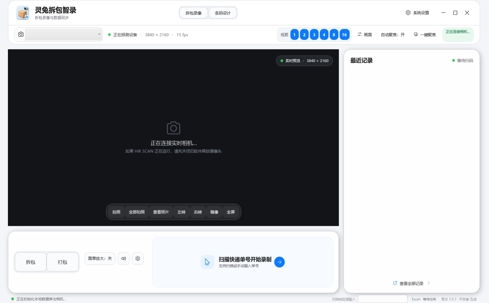
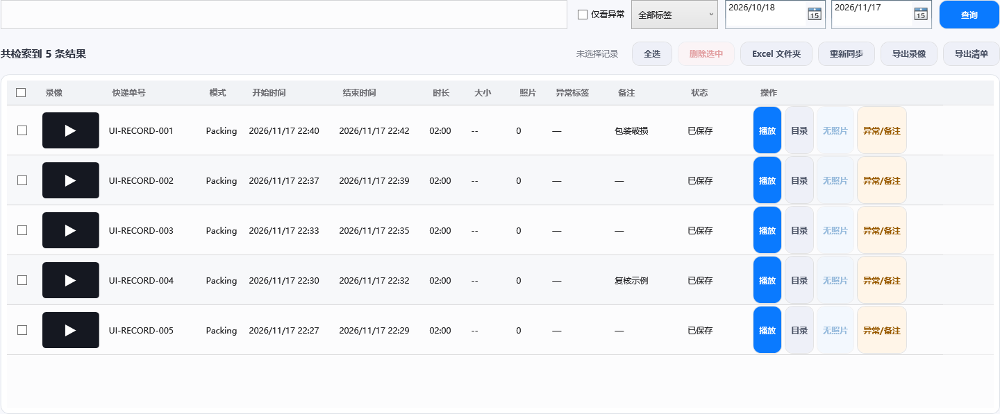
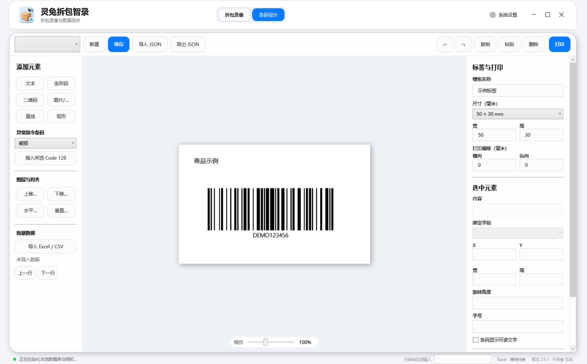

# 灵兔拆包智录使用教程（2.6.3 预发布版）

本文面向使用 Windows 安装版的普通用户，按“下载 → 首启 → 扫码录像 → 数据 → 手机 → 条码 → 迁移 → 卸载”的实际操作顺序编排。**阅读本教程不需要安装 .NET SDK，也不需要编译源码。**

- 适用版本：**2.6.3 预发布（Prerelease）**
- 适用系统：Windows 10 / 11
- 软件界面语言：简体中文
- English: [English user guide](user-guide.en.md)
- 返回：[项目首页](../README.md)

## 目录

1. [开始之前：安全与数据须知](#1-开始之前安全与数据须知)
2. [下载与校验](#2-下载与校验)
3. [安装 Windows 版](#3-安装-windows-版)
4. [首次启动：协议与隐私](#4-首次启动协议与隐私)
5. [首启向导：录像目录、Excel 与恢复检查](#5-首启向导录像目录excel-与恢复检查)
6. [摄像头配置与机位测试](#6-摄像头配置与机位测试)
7. [选择录像目录与可选 Excel](#7-选择录像目录与可选-excel)
8. [扫码开始、结束与切换单号](#8-扫码开始结束与切换单号)
9. [录制异常、备注与快照](#9-录制异常备注与快照)
10. [历史检索、回放与同步状态](#10-历史检索回放与同步状态)
11. [Excel 同步失败与手动重试](#11-excel-同步失败与手动重试)
12. [手机配对](#12-手机配对)
13. [手机扫码器、智能摄像头与异常控制](#13-手机扫码器智能摄像头与异常控制)
14. [热敏条码设计器](#14-热敏条码设计器)
15. [HIK SCAN 兼容同步](#15-hik-scan-兼容同步)
16. [单机位优先与多机位预发布限制](#16-单机位优先与多机位预发布限制)
17. [备份、恢复与迁移](#17-备份恢复与迁移)
18. [更新软件](#18-更新软件)
19. [安全卸载](#19-安全卸载)
20. [常见问题](#20-常见问题)
21. [验收边界](#21-验收边界)

---

## 1. 开始之前：安全与数据须知

先花两分钟确认下面几件事，可以避免绝大多数“数据找不回来”的问题。

1. **先备份业务资料。** 开始试用、升级、修改录像目录或更换电脑之前，先把现有录像目录、Excel 工作簿和标签模板复制一份到另一块磁盘或移动硬盘。
2. **测试时使用示例数据。** 熟悉流程时请用自己编造的示例单号、示例工作簿和示例标签；不要把真实客户单号、真实工作簿路径或真实配对信息写进截图、教程、Issue 或聊天记录。
3. **不要公开配对二维码。** 电脑上显示的配对二维码等同于一次登录凭据，五分钟内有效且只能使用一次；不要截图发群、不要贴到网上。
4. **不要轻率删除业务数据。** 历史记录里的“删除选中”和卸载时的“永久删除”都可能清理录像文件。删除前先确认备份可用。
5. **2.6.3 是预发布版。** Windows 安装器尚未取得可信代码签名，只有 Prerelease；实机相机、扫码枪、手机配对和长时间录像的验收结果以该版本的验收记录为准，本教程不替代现场验收。
6. **单机位优先。** 第一次使用请先用“单机位”把流程跑通，再考虑多机位。

---

## 2. 下载与校验

1. 打开项目发布页：<https://github.com/907609732/lingtu-recorder/releases>，选择 **v2.6.3**。
2. 在 Assets 中下载 Windows 安装器 `EcommerceUnpackRecorder-win-Setup.exe`。直链：
   <https://github.com/907609732/lingtu-recorder/releases/download/v2.6.3/EcommerceUnpackRecorder-win-Setup.exe>
3. 需要用手机协同时，再下载安卓安装包 `EcommerceUnpackRecorder-Android.apk`。直链：
   <https://github.com/907609732/lingtu-recorder/releases/download/v2.6.3/EcommerceUnpackRecorder-Android.apk>
4. 在发布页找到该版本公布的 **SHA256**。如果该版本同时附带 `SHA256SUMS.txt`，把它和安装包放在同一目录。
5. 在安装包所在目录打开 PowerShell，计算并逐字比对哈希（大小写不敏感）：

```powershell
Get-FileHash -Algorithm SHA256 -LiteralPath .\EcommerceUnpackRecorder-win-Setup.exe
```

6. 哈希与发布页公布值不一致时**不要安装**，删除文件后重新下载；仍然不一致就不要使用该文件。
7. 当前安装器未签名，`Get-AuthenticodeSignature` 显示无签名属于已知情况，不能据此判断文件安全；请以“下载来源 + 发布页 SHA256 + 版本号”三者一致为准。
8. 官网（record.lttlt.top）不承载大文件，安装包只从 GitHub Releases 获取。

> 注意：不要从第三方网盘、群文件或重打包站点下载安装包；也不要为了绕过 SmartScreen 而关闭系统安全功能。

---

## 3. 安装 Windows 版

1. 双击 `EcommerceUnpackRecorder-win-Setup.exe`。
2. 按提示完成 **每用户安装**（Velopack）。安装版用户**不需要** .NET SDK、Visual Studio 或 Android Studio。
3. 如果出现 SmartScreen 提示，先确认文件名、版本号和下载来源都来自上面的发布页，再选择继续。
4. 安装完成后从开始菜单启动“灵兔拆包智录”。
5. 后续更新由软件在后台下载，并在**录像空闲且你确认后**安装，不需要手工覆盖旧文件（见第 18 节）。
6. 覆盖升级前请先结束当前录像并退出软件；升级通常会保留现有业务数据，但仍请先备份后再升级。

---

## 4. 首次启动：协议与隐私

1. 首次启动会先显示“首次使用前，请了解本地数据、相机和更新行为”窗口。
2. 点击 **查看用户协议**、**查看隐私政策** 阅读全文。
3. 确认已理解：单号、录像、备注和 Excel 默认只保存在本机；可选匿名日活只发送每日匿名值、平台和版本。
4. **帮助作者统计匿名日活（可选，可随时关闭）复选框默认已勾选**；不需要时请先取消，之后也可以在设置中随时关闭，取消不影响任何功能。本教程只依据界面与源码说明，不声称已实测联网或统计上报结果。
5. 勾选 **我已阅读并同意《用户协议》和《隐私政策》**，再点击 **同意并继续**。
6. 暂不同意时点击 **不同意并退出**，软件不会进入相机和联网流程。
7. 相机权限在真正进入扫码或摄像功能时才申请；当前版本不申请麦克风权限。

---

## 5. 首启向导：录像目录、Excel 与恢复检查

向导共五步，大约一分钟：**1 欢迎 → 2 录像目录 → 3 Excel 表格 → 4 恢复检查 → 5 完成**。底部按钮为 **上一步**、**退出**、**下一步**，最后一步的“下一步”会变成 **进入软件**。

1. **第 1 步 欢迎**：阅读“业务数据由你自己保管”。录像、单号、异常标签和备注默认保存在本机；软件会在录像目录建立一个隐藏的便携索引 `.unpackvision`，用于以后重装或换机恢复。
2. **第 2 步 录像目录**：点击 **选择目录**，选一个空间充足、会定期备份的磁盘目录；再点击 **检查目录**，确认可写、空间足够。
3. **第 3 步 Excel 表格**：三选一。
   - **选择现有表格**：绑定你已有的业务工作簿（只接受 `.xlsx`，工作表名与前六列表头需匹配，详见第 7 节）。
   - **生成新表格**：创建一个标准六列表格。
   - **暂时跳过**：不影响录像，之后可在“系统设置 → 存储与数据”补充。
4. **第 4 步 恢复检查**：查看“历史数据扫描结果”。如果扫描到可恢复记录，**“完成配置时将可恢复记录合并到本机数据库”默认已勾选**；先核对预览中的数量，不想合并就先**取消勾选**。注意：**在这一步点击“下一步”时就会立即执行合并**，不会再弹一次确认；无法确定的标签和异常时间会标明为部分恢复，不会伪造。
5. **第 5 步 完成**：显示“配置已准备好”，核对录像目录与 Excel 后结束向导。绑定现有 Excel 时只校验能否独占读写、是否被占用、工作表名与前六列表头是否匹配，**不会写入测试行**。
6. 之后再次修改路径，都在“系统设置 → 存储与数据”中完成，并且**修改仅在点击“保存设置”后生效**。

> 注意：Excel 可以随时补上，录像目录请一次选好。目录确定后尽量不要频繁搬动，迁移请走第 17 节的流程。

---

## 6. 摄像头配置与机位测试

### 6.1 在设置中选择录像模式

1. 打开 **系统设置**（右上角齿轮，或主界面底部齿轮按钮）。
2. 切到 **相机信息** 页。
3. 在“1 选择录像模式”中选择 **单机位**。普通拆包场景先用这个。
4. 需要多角度时再选 **多机位（最多16路）**，并阅读页内提示：单机位仅使用主机位。
5. 需要合成片时勾选 **同时生成多机位合成视频（5路以上默认关闭）**；日常建议先不勾选。

### 6.2 选择并配置摄像头

1. 在“机位列表”中双击一个机位，或选中后点击 **配置选中机位**。
2. 在“配置机位”窗口中填写 **机位名称**，再选择 **来源类型**：
   - **自动选择本地摄像头**：由软件按分辨率要求自动挑一个可用相机。
   - **指定 Windows 摄像头（USB / iVCam）**：在“选择本地摄像头”列表中明确指定设备。
   - **IPC / 自定义 RTSP、HTTP 视频流**：填写完整视频流地址，账号密码用 Windows DPAPI 加密保存。
   - **海康威视 NVR / DVR**：填写录像机地址、端口、通道和主/副码流；可点 **发现并添加全部通道**。
3. 点击 **开始预览**，确认画面方向、分辨率、帧率正常；必要时展开“高级录像与画面参数”调整分辨率、帧率、亮度和镜像。
4. 点击 **保存机位**。取消不会修改原机位。
5. 局域网相机可用 **扫描局域网 IPC** 辅助发现，但“发现成功不等于视频流已验证”，必须在预览里看到画面后再保存。

### 6.3 测试并保存

1. 回到 **相机信息** 的“2 测试并保存”。
2. 点击 **测试当前机位**（单机位只需要这一步）；多机位点击 **测试全部机位**。
3. 查看状态行的分辨率、帧率、预计码率、每小时占用和可录时长。多机位配置改动后必须重新测试。
4. 点击右下角 **保存设置**。未保存前所有修改都不生效。

### 6.4 主界面日常调整

- 顶部左侧下拉框可切换 **自动模式** 或指定本地相机序号。
- **自动聚焦：开**、**一键聚焦** 用于调清晰度；**画面** 按钮打开“画面参数”（亮度、对比度、清晰度、饱和度、恢复默认）。
- 预览下方按钮：**拍照**、**全部拍照**、**查看照片**、**左转**、**右转**、**镜像**、**全屏**。
- 建议在开始录像前确认视频源和画面；现场临时换来源前，先结束当前录像。

> 注意：独立录像端需要独占相机。如果预览一直显示“正在连接实时相机…”，先关闭正在运行的 HIK SCAN 或其他监控软件。

---

## 7. 选择录像目录与可选 Excel

1. 打开 **系统设置 → 存储与数据**。
2. **主录像位置**：点击 **选择** 更换目录。保存时软件会先统计旧目录中的完成录像和 `.unpackvision` 便携索引，再询问是否迁移；这是迁移而不是恢复，操作前请先备份，细节见第 17 节。
3. **Excel 工作簿**：
   - **选择** 绑定现有工作簿。只接受 `.xlsx`；工作表名必须精确为 `退货扫码单号`；前六列表头必须依次为 `扫码日期`、`快递单号`、`关联结果`、`金额`、`备注`、`图片凭证`。绑定过程只做独占读写、占用状态和表头校验，不写入测试行。
   - **生成** 创建标准六列表格（含冻结首行、自动筛选和隐藏的同步标记工作表）。
4. **工作区状态** 会显示当前向导是否完成、目录是否可用；异常时会给出原因。
5. **录像盘位**：点击 **管理录像盘位** 可添加多个硬盘目录、上移/下移、启用/停用、移除盘位和 **检查全部**。移除盘位只删除配置，不删除录像。
6. 同一个包裹的全部视频会保存在同一个盘位；空间不足时从下一单开始切换到后续可用盘位。
7. 点击 **保存设置** 生效。
8. “数据检查与恢复”区域提供 **检查旧数据**、**重建本机数据库**、**查看恢复报告** 三个入口，用法见第 17 节。

> 注意：Excel 被占用时软件不会强行写入，任务会留在 SQLite 队列中，工作簿关闭后自动重试。工作表名或表头不匹配时不会写入，请先改成标准模板或使用“生成”。

---

## 8. 扫码开始、结束与切换单号



*界面为隔离渲染，未连接相机。*

### 8.1 日常三步

1. 在主界面底部确认当前模式：**拆包** 或 **打包**。模式决定录像落到 `Unpacking` 还是 `Packing` 子目录。
2. 扫描普通快递单号。识别成功后立即开始录像，画面叠加时间和单号水印，右侧“最近记录”出现“录制中”。
3. 结束方式二选一：
   - **再次扫描当前单号**：安全结束编码、保存 MP4，并进入同步队列。
   - **扫描新单号**：先保存当前录像，再自动开始下一单，现场无需等待。
4. 扫码枪异常时，点击当前录像面板里的 **结束录像** 手动收单；保存过程中不要强制关闭程序。

### 8.2 手动输入与扫码枪

- 主界面底部右侧有 **扫码枪回退输入** 输入框，扫码枪不可用时可手动粘贴或输入单号。
- 主界面中央的 **扫描快递单号开始录制** 面板提示“支持扫描或手动输入单号”。

### 8.3 单号规则

打开 **系统设置 → 单号配置**：

1. **单号长度**：设置最短、最长位数，超出范围的内容不会作为快递单号开始录像。
2. **过滤开头**、**过滤结尾**：需要时去掉扫码枪附带的固定前后缀。
3. **防误扫间隔（毫秒）**：忽略短时间内重复出现的同一输入。
4. 点击 **保存设置**。

### 8.4 时长与语音

打开 **系统设置 → 存储与数据 → 启动与语音**：

1. **最长录像**（分钟）：到达上限时软件会弹窗询问 **继续录像** 还是 **停止并保存**，选择继续会重新计时；默认 5 分钟。它不会静默自动停止。
2. **启动后立即显示实时相机**、**启用开始、停止和异常语音播报** 可按现场需要开关。
3. **播报音量** 可拖动并用 **试听** 检查。

> 注意：单号在数据库中按文本保存，字母、横线和前导零都会保留；重复单号会在“最近记录”中显示“重复”标记。

---

## 9. 录制异常、备注与快照

### 9.1 配置异常标签

打开 **系统设置 → 异常标签**：

1. 表格中可 **启用**、修改 **名称**、**颜色**，**固定条码内容** 只读，不会因改名或改色而改变。
2. 点击 **新增标签** 添加自定义标签，**删除选中** 移除不需要的标签。
3. 默认提供“破损”“调包”等快捷标签；**固定撤销条码：UV-UNDO-TAG** 可用于撤销最近一个标签。
4. 需要保留现场画面时勾选 **扫描异常标签时自动截取当前画面（首次默认关闭）**。
5. 点击 **保存设置**。

### 9.2 录制中添加异常与备注

1. 录像进行中，点击当前录像面板里的 **破损**、**调包** 等快捷按钮，或用扫码枪扫描对应的异常指令条码。异常条码优先于普通快递单号。
2. 一个包裹可以添加多个标签；状态行会显示“当前没有异常标签”或已有标签摘要。
3. 点错了就点击当前录像面板里的 **撤销标签**（只撤销最后一个活动标签），不要等录像结束再改。
4. 在备注框输入问题描述，停止输入约 500 毫秒后自动保存，不需要额外点按钮。
5. 需要立即收单时点击 **结束录像**。
6. 异常会进入实时水印、录像文件名、本机数据库、历史检索和 Excel 的 E 列；**人工在 Excel 里写的备注不会被覆盖**。
7. 需要给别人看包裹照片时，在“最近记录”里点击照片数量按钮打开照片窗口。

> 注意：异常标签会影响录像文件名和 Excel 内容，误加标签请当场撤销，不要事后直接改数据库。

---

## 10. 历史检索、回放与同步状态



*图中记录为示例数据。*

1. 在主界面右侧“最近记录”底部点击 **查看全部记录**，打开“全部记录”窗口。
2. 顶部检索条件：
   - 搜索框支持 **快递单号或备注**；
   - 勾选 **仅看异常**；
   - 选择异常标签；
   - 选择开始日期和结束日期；
   - 点击 **查询**。
3. 列表列包含：录像缩略图、快递单号、模式、开始时间、结束时间、时长、大小、照片、异常标签、备注、状态、操作。
4. **状态** 列会显示 **Excel 已同步 / Excel 同步中 / Excel 同步失败 / Excel 等待同步 / HIK 历史基线 / 已保存 / 异常 / 录制中** 等状态。
5. 行内操作：
   - **播放**：打开播放器；
   - **目录**：在资源管理器中打开该录像所在目录；
   - **照片**：查看该单的异常截图；
   - **异常/备注**：修改标签和备注。
6. 播放器中：
   - 多机位录像左侧显示 **同步画面**，可切换机位并保持当前时间位置；
   - **暂停**、进度条和 0.5× / 1.0× / 1.5× / 2.0× 倍速；
   - 点击异常时间点可直接跳转到对应画面。
7. 工具栏操作：**加载更多**、**全选**、**删除选中**、**Excel 文件夹**、**重新同步**、**导出录像**、**导出清单**（CSV）。其中 **重新同步** 会按 Excel 连接器把所有**尚未成功**的任务（等待、失败、处理中）重置为等待并重新排队（`RetryConnectorAsync("excel")`，条件是 `connector_id` 匹配且 `status <> 'Succeeded'`），与当前选中行无关，也不需要先选中记录。
8. 多选：按住 Ctrl 点选，或按住 Shift 连选。
9. 日期筛选按记录的扫码时间，默认最近 30 天；每次加载约 100 条，可点 **加载更多** 继续。

> 注意：删除历史记录不会删除 Excel 中已经写入的行；包含“正在录制或保存”的记录时，软件会拒绝删除并提示等待。删除文件时请确认备份。

> 关于同步状态：主界面“最近记录”卡片上的绿色“已同步”是固定界面文案，不代表该单已经写入 Excel。请以“全部记录”的 **状态** 列或同步提示为准。

---

## 11. Excel 同步失败与手动重试

1. 录像保存后，单号、日期、异常备注（以及满足条件时的平台关联公式）进入可靠同步队列。主界面底部会显示 `Excel：等待任务`、`Excel：本轮处理 N 条` 等提示。
2. 写入规则（不需要手工处理）：在 B 列最后一个真实非空单元格之后追加；A 列写真实日期；B 列强制文本；D、F 保持空白；E 列写入兼容标记 `【拆包智录】` 并合并异常/备注。**C 列只有在工作簿同时存在旧版拼多多、淘宝、京东三张平台关联表时才写入平台关联公式，否则保持空白**——标准六列表格的 C 列为空属于正常现象。
3. 每次写入前会建立恢复副本，默认在 `%LOCALAPPDATA%\UnpackVision\Backups`，再用临时文件和原子替换保存。
4. 如果状态长期是 **Excel 等待同步**：
   1. 关闭正在占用工作簿的 Excel、WPS 或业务系统；
   2. 确认工作簿不是只读、不在被同步网盘锁定；
   3. 回到“全部记录”，直接点击 **重新同步**；它会把 Excel 连接器中所有**尚未成功（等待、失败、处理中）**的任务重置为等待并重新排队，不需要也不只作用于选中记录；
   4. 提示“失败或等待中的 Excel 同步任务已重新排队”只是界面文案；实际范围包含处理中的任务，等待队列会自动处理。
5. 需要确认工作簿位置时，点击 **Excel 文件夹** 直接打开所在目录。
6. 队列保存在 SQLite 中，重启软件不会丢失待同步任务。

> 注意：不要同时让多个自动写入程序操作同一个工作簿；首次试运行请复制一份工作簿，并在“系统设置 → 存储与数据”中选择这个副本。普通生产模式下兼容服务也以桌面设置为准，`Excel__WorkbookPath` 环境变量不会覆盖它。

---

## 12. 手机配对

### 12.1 准备

1. 电脑和手机连接**同一个专用局域网**（同一路由器或同一手机热点）。不要把工位端口映射到公网。
2. 电脑端软件已在运行，工位服务在线。
3. 手机安装同版本的 `EcommerceUnpackRecorder-Android.apk`。

### 12.2 电脑端生成二维码

1. 打开 **系统设置 → 手机协同**。
2. 点击 **显示手机配对二维码**，打开“配对安卓手机”窗口。
3. **在这个窗口里**选择 **局域网地址（手机和电脑须在同一网段）**：多网卡电脑要选手机所在网段的那一个地址。
4. 窗口状态变为“工位主机已就绪，请用手机扫描二维码”。选错地址或二维码过期时，改好地址后点击 **刷新二维码** 重新生成。
5. 二维码 **五分钟有效且只能使用一次**；不要截图外传。

### 12.3 手机端扫码

1. 打开手机 App，在首页点击 **连接**（已配对过则点 **重新配对**）。
2. 进入“配对电脑”页面，点击 **允许使用摄像头**，对准电脑屏幕上的二维码。
3. 成功后显示“配对成功”和工位编号，并给出中文语音与震动反馈。
4. 如果提示“工位服务在线，但电脑录像程序未打开”，回到电脑确认主程序已启动。

### 12.4 管理设备

1. 在 **系统设置 → 手机协同** 点击 **管理已配对设备**。
2. 列表显示设备名称、状态、角色、权限、配对时间和最近在线时间。
3. 选中设备后点击 **删除选中设备**，该手机会立即失去全部权限，必须重新扫码配对。
4. 不再使用的手机请及时删除，丢失或转手的手机尤其重要。

> 注意：每台手机使用独立密钥，工位令牌由 Android Keystore 保护，电脑数据库只保存令牌摘要。更换电脑或恢复工作区后，业务记录可以恢复，但手机必须重新配对。

---

## 13. 手机扫码器、智能摄像头与异常控制

手机首页“选择工作方式”只有两张入口卡片：**手机扫码器** 和 **智能摄像头**（上方还有连接/重新配对卡片，右上角是“设置”）。源码里虽然定义了更多工作类型，但界面没有把它们做成首页入口：

- “仅收集单号”是 **手机扫码器** 中 **更多设置 → 启动电脑录像** 的关闭状态；
- 异常控制（标签、备注、截图、停止）内嵌在 **手机扫码器** 页面底部，不是独立页面。

### 13.1 手机扫码器

1. 在首页选择 **手机扫码器**（“全屏扫码，可选择是否同时启动电脑录像”）。
2. 确认页面顶部显示“电脑已连接”；未连接时先回到首页重新连接。
3. 展开 **更多设置 ▼**，按需切换 **启动电脑录像**：
   - 开启：“扫码将开始、结束或切换电脑录像”；
   - 关闭：“仅收集单号并同步 Excel”，即源码中的仅收集单号分支——扫码先写入手机离线队列，再尝试提交电脑并进入 Excel 队列。
4. 对准面单条码扫描，由电脑决定开始、结束或换单。电脑确认后手机给出“单号已收集”等中文提示。
5. 网络不稳定时会出现 **已离线保存，联网后自动补发**，并显示 **待同步 N**；恢复网络或再次扫码时自动补发。
6. 光线不足时可打开 **闪光灯**。

### 13.2 异常控制（内嵌在手机扫码器页面）

1. 页面底部显示“电脑已连接/未连接”和“正在录像：单号”或“电脑空闲”；点击 **刷新状态** 重新读取。
2. 可用操作：
   - **破损**、**调包**、**少件**、**采购**：给当前录像添加标签；
   - **问题备注**：输入后点击 **保存**；输入框最多 2000 字，超长内容电脑端也会拒绝；
   - **截图**：保存当前画面；
   - **停止**：结束并保存当前录像。
3. **手机界面当前没有可见的撤销按钮**。标签加错时，请在电脑端当前录像面板点击 **撤销标签**，或用扫码枪扫描固定撤销条码 `UV-UNDO-TAG`。
4. 所有异常操作都要求电脑当前处于“录制中”；空闲或保存中发送会被拒绝。
5. 电脑确认后手机给出中文语音与震动反馈。

### 13.3 智能摄像头

1. 在首页选择 **智能摄像头**（“把手机作为电脑摄像头，并自动识别快递单号”）。
2. 确认状态为“电脑已连接 · 等待扫码”；首次推流前可能是“视频服务已就绪，点击开始推流”。
3. 点击 **开始推流**，图像通过 RTSPS 送到电脑；**未开始推流时扫码会被拒绝**，并提示“请先开始推流，再扫描快递单号”。点击 **停止推流** 结束。
4. 需要切换前后镜头时点击 **切换镜头**；光线不足时在“更多设置”里打开 **闪光灯**。
5. 画面下方会显示最近识别到的单号与上传码率。
6. 识别规则：同一码需要在 **300 毫秒稳定窗口内命中两次** 才发送，离开扫码区 **1.2 秒** 后才允许同码再次触发，避免重复。

> 注意：手机端界面为中文，且没有历史记录页，检索与播放仍在 Windows 端。局域网明文只在开发调试的 `127.0.0.1` 反向通道上允许，正式使用不要尝试关闭证书校验或改用明文局域网地址。

---

## 14. 热敏条码设计器



*图中标签为示例。*

1. 在主界面顶部点击 **条码设计**。**录像不会中断**，可以随时切回 **拆包录像**。
2. 顶部工具栏：**新建**、**保存**、**导入 JSON**、**导出 JSON**、撤销 ↶、重做 ↷、**复制**、**粘贴**、**删除**、**打印**。
3. 左侧“添加元素”：**文本**、**条形码**（Code 128）、**二维码**、**图片/Logo**、**直线**、**矩形**。
4. “异常指令条码”区域可选择一个异常标签，点击 **插入所选 Code 128**，把破损/调包等指令条码印在标签上，现场用扫码枪即可触发。
5. “图层与对齐”：**上移一层**、**下移一层**、**水平居中**、**垂直居中**。
6. “批量数据”：
   1. 点击 **导入 Excel / CSV** 选择数据文件；
   2. 状态行显示已导入行数；
   3. 用 **上一行**、**下一行** 预览不同记录；
   4. 在右侧“选中元素”的 **绑定字段** 下拉框里选择要套用的列。
7. 右侧“标签与打印”：
   - **模板名称**；
   - **尺寸（毫米）**：50 × 30 mm、60 × 40 mm 或 **自定义**；
   - **打印偏移（毫米）**：横向、纵向微调；
   - **打印范围**：起始行 / 结束行（留空为全部）；
   - **每行份数**。
8. “选中元素”可修改 **内容**、**绑定字段**、X/Y、宽/高、**旋转角度**、**字号**，并勾选 **条码显示可读文字**。画布元素支持拖动、缩放、旋转和复制粘贴。
9. 完成后点击 **保存**，模板保存在 `%LOCALAPPDATA%\UnpackVision\Templates`；点击 **打印** 输出到已安装的 Windows 打印机驱动。

> 注意：设计器通过已安装的 Windows 打印机驱动打印；纸张、浓度和厂商专有选项请在打印机驱动中设置。首次打印请用普通纸试打，校准偏移后再上热敏纸；批量打印前先用 2～3 行示例数据验证。

---

## 15. HIK SCAN 兼容同步

先区分两个不同的“海康”能力：

- **本节**：HIK SCAN 录像文件兼容同步——只读监控 HIK SCAN 生成的 MP4 目录，解析后写入数据库和 Excel。
- **相机来源**：在“系统设置 → 相机信息 → 配置选中机位 → 来源类型 → 海康威视 NVR / DVR”里把录像机通道当作摄像输入。它不走兼容服务，也不需要 HIK SCAN 目录。

兼容同步的操作顺序：

1. 确认要监控的拆包、打包录像目录（HIK SCAN 的 `LogisticsUnpacking`、`LogisticsPaking` 一类路径）。服务只扫描这两个目录的顶层 `*.mp4`，不递归子目录。
2. **Excel 路径以桌面端设置为准**：普通生产模式下，兼容服务启动时会用桌面端 `settings.json` 覆盖服务配置里的录像目录和 Excel 路径，因此 `Excel__WorkbookPath` 环境变量通常不生效。请先在桌面端“系统设置 → 存储与数据”选择工作簿。
3. HIK 目录本身仍可用环境变量覆盖（它们不经过桌面设置覆盖）：

```powershell
$env:HikCompatibility__UnpackingDirectory = 'D:\HIK SCAN\storage\LogisticsUnpacking'
$env:HikCompatibility__PackingDirectory = 'D:\HIK SCAN\storage\LogisticsPaking'
powershell -ExecutionPolicy Bypass -File .\scripts\run-service.ps1
```

4. 只有显式设置 `UNPACKVISION_ALLOW_TEST_INSTANCE=1` 的隔离测试实例才会沿用环境变量里的录像目录和 Excel 路径；该开关只用于临时测试路径，不要指向真实业务数据。
5. 服务会等 MP4 连续稳定、并能读出一帧后，再解析单号和起止时间，写入本机 SQLite，并通过可靠重试队列同步 Excel。文件名需符合 `单号_14位开始时间_14位结束时间.mp4` 的命名规则。
6. **首次运行只登记已有历史录像，不自动补写 Excel**；之后产生的新录像才会自动进入同步队列。历史记录状态会显示为 **HIK 历史基线**。
7. 需要用本机 API 时，先查看密钥：

```powershell
powershell -ExecutionPolicy Bypass -File .\scripts\run-service.ps1 -ShowApiKey
```

8. 除 `/api/v1/health` 外，请求都要带 `X-UnpackVision-Key: <本机 API 密钥>`。
9. 2.6.3 的兼容服务强制回环监听，并校验连接与 Host；不要把服务端口暴露到局域网或公网。

> 注意：兼容同步服务可以和 HIK SCAN 同时运行，它只读录像目录；但独立录像桌面端需要独占相机，使用桌面端录像时应先退出 HIK SCAN。**安装版如何启动该服务尚未核实**：发布脚本只是把 `UnpackVision.Service` 生成到发布暂存根目录 `App` 下的 `Service` 子目录；最终安装后的具体位置和启动方式尚未核实，仓库中也没有桌面端自动拉起或注册开机启动的实现记录，请不要假设打开桌面端就会同步 HIK 目录；源码环境可用 `scripts\run-service.ps1` 启动并观察日志。源码仓库根目录的 `Start-Sync-Service.cmd` 硬编码查找 `artifacts\publish\staging\2.3.0`，只对那次 staging 输出有效，不能当作所有版本的通用入口。

---

## 16. 单机位优先与多机位预发布限制

### 16.1 建议路径

1. 先用 **单机位** 完整跑通：相机预览 → 扫码录像 → 异常备注 → 历史播放 → Excel 同步。
2. 稳定后再在 **系统设置 → 相机信息** 切换到 **多机位（最多16路）**，逐个添加机位并指定主机位。
3. 每次改动机位、合成选项或盘位后，重新执行 **测试全部机位**，再保存。

### 16.2 预发布限制（2.6.3 仍然适用）

- 配置上限为 16 个 USB、虚拟、手机、IPC 或海康录像机通道；每台电脑真正可用的路数必须由全链路性能测试决定。
- 1 至 4 路默认保存各机位原片和 1080p 合成视频；5 至 16 路默认关闭合成片，优先保护独立原片。
- 主机位是必需机位；写入器失败或连续 5 秒没有画面会自动安全收单。副机位断线会自动重连，并留下可审计的媒体缺口，不会被误报为完整录像。
- 5 至 16 路的 60 秒性能结果绑定当前机位、合成选项和全部启用盘位；任一配置变化后必须重新测试。
- 历史播放器默认最多同步播放 4 路；8/16 路回放要等后续性能准入。
- 多盘拔盘、盘符变化和空间预警仍需在发布前完成实盘验收。
- 本仓库尚未记录 8/16 路两小时实体机、100 个包裹和多盘故障切换验收。

> 注意：上述限制不是“已知可以忽略的小问题”，而是当前版本的能力边界。请按实际业务量先做小批量试运行，再扩大规模。

---

## 17. 备份、恢复与迁移

### 17.1 必须一起备份的内容

1. **整个录像目录**（含隐藏的 `.unpackvision`）：保存单号、时间、相对录像路径、标签、异常时间、备注和同步状态。
2. **Excel 工作簿**。
3. `%LOCALAPPDATA%\UnpackVision\unpackvision.db`（记录数据库）和同目录的 `settings.json`（设置）。
4. `%LOCALAPPDATA%\UnpackVision\Templates`（热敏标签模板）。

只复制 MP4 时，符合本软件命名规则的录像仍可按文件名**部分恢复**单号、起止时间，以及文件名异常后缀里记录的标签名。恢复时生成的异常时间是占位值，不能用于定位真实异常；备注、真实异常时间点和同步状态等无法从文件名还原，**可能丢失**。便携索引**不保存**摄像头密码、手机令牌或 API 密钥。

### 17.2 修改录像目录并迁移

1. 先做一次完整备份。
2. 打开 **系统设置 → 存储与数据**，在 **主录像位置** 点击 **选择**。
3. 点击 **保存设置**，软件统计旧目录中的完成录像和 `.unpackvision`，询问是否迁移。
4. 选择迁移后，软件会复制并逐个校验，原子保存新位置，再尝试移除与本机校验记录（长度与 SHA-256）一致的源文件。
5. 迁移过程中会显示“正在安全迁移录像”和进度，请勿关闭窗口或断开存储设备。
6. 目标缺失、内容变化或被占用的旧文件不会被清理，会列出供你重试。
7. 空间不足、权限不足或文件冲突会阻止切换。
8. 代码只清理已验证的源副本，但断电、硬件或文件系统故障无法完全排除，因此**迁移前请另存一份完整备份**，不要把迁移当作备份手段。

### 17.3 更换电脑

1. 在新电脑安装同版本的灵兔拆包智录。
2. 如果是**首次启动**：在向导第 2 步选择原录像目录，第 3 步选择原 Excel，第 4 步会显示“历史数据扫描结果”恢复预览。扫描到可恢复记录时合并选项**默认已勾选**：核对无误可直接点 **下一步**（点击即执行合并）；不希望合并就先取消勾选再点 **下一步**。
3. 如果**软件已经配置过**：打开 **系统设置 → 存储与数据**，在 **主录像位置** 和 **Excel 工作簿** 中重新选择原位置并点击 **保存设置**。保存录像位置会先触发**迁移询问**（把当前目录的文件搬到新选择的位置），它不是恢复流程；确认备份后再决定是否迁移。
4. 恢复记录要单独操作：在“数据检查与恢复”中先点 **检查旧数据** 只查看分类数量，再点 **重建本机数据库**，确认后才会备份当前数据库并合并记录。
5. 重新配置摄像头与机位，重新执行机位测试。
6. 在 **手机协同** 中重新生成二维码并配对所有手机。

### 17.4 旧目录没有便携索引

1. 先另存一份录像目录与 Excel 的完整备份。
2. 打开 **系统设置 → 存储与数据 → 数据检查与恢复**。
3. 点击 **检查旧数据**：这一步只做预览，显示“完整 / 仅文件名 / Excel 关联 / 冲突 / 录像缺失 / 无效”的数量，**不会合并、不会移动或改写录像**。
4. 数量符合预期后，点击 **重建本机数据库** 并确认。对话框会说明“恢复前会备份当前数据库，并以字段更新时间智能合并。不会删除或覆盖录像文件”。
5. 需要留档时再点击 **查看恢复报告**，报告只用于核对，不会自动补写 Excel。

> 注意：迁移不等于备份。任何一次迁移前都要另存一份完整副本；不要在软件运行中手工移动或改名录像目录里的文件。

---

## 18. 更新软件

### 18.1 Windows

1. 顶部出现“发现新版本”横幅时，可先点 **更新说明** 查看变更，再点 **重启并安装** 或 **稍后**。
2. 也可以打开 **系统设置 → 关于**：
   - 勾选 **自动检查并在后台下载更新**；
   - 点击 **立即检查更新**；
   - 有可用版本时点击 **重启并安装**，或 **查看最新版本**、**下载 Windows 安装器**。
3. 安装更新前请先结束当前录像并保存；更新会等待录像空闲并经你确认后再执行。
4. 升级通常会保留数据库、设置、录像和 Excel，但任何升级都可能出现意外；请先在升级前完成完整备份，升级后再核对记录列表与工作簿。

### 18.2 安卓

1. 打开手机 App **设置 → 软件更新**，点击 **立即检查**。
2. 发现新版本后点击 **下载并校验更新**，等待“下载及 SHA256 校验完成”。
3. 点击 **打开系统安装界面**；若提示“请允许安装未知应用”，授权后返回再次点击。
4. 安卓必须使用**同签名**的升级包，卸载重装会丢失配对状态，需要重新扫码。

> 注意：更新只访问灵兔官网与 GitHub，不上传单号、录像、Excel 或设备信息。不要使用来源不明的更新包。

---

## 19. 安全卸载

1. **保持软件打开**，先结束并保存当前录像（录制、启动或保存中时，安全卸载会提示“请先完成当前包裹”），再确认备份可用。
2. 打开 **系统设置 → 关于 → 卸载与数据保留**。
3. 点击 **安全卸载灵兔拆包智录**，进入“安全卸载”窗口。如果当前是开发版或便携版、没有 Velopack 卸载器，软件会提示改从 Windows“设置 → 应用”卸载。
4. 两种选择：
   - **保留全部业务数据（推荐）**：只删除程序、快捷方式和卸载注册项，保留数据库、设置、配对信息、录像和 Excel。重新安装后可继续使用。
   - **永久删除灵兔拆包智录的本机数据和录像**：会连续弹出两次警告，并验证录像目录中的 `.unpackvision/workspace.json` 与当前工作区 ID；验证失败时拒绝删除。
5. 确认“将要处理的位置”，特别是 **Excel（始终保留）** 一项。
6. 点击 **继续卸载**。
7. 永久清理只处理 `Unpacking`、`Packing`、`Snapshots`、`.unpackvision` 和 `%LOCALAPPDATA%\UnpackVision`；Excel 和录像目录中的其他文件始终保留。
8. 直接从 Windows“设置 → 应用 → 已安装的应用”卸载时，不会取得删除业务数据的授权，因此默认保留所有业务数据。

> 注意：永久删除后，录像和便携索引无法从软件内恢复。确认备份已经复制到另一块磁盘后再执行。

---

## 20. 常见问题

**Q1：扫描单号没有开始录像？**
先确认相机状态为可用、没有其他软件占用相机；再检查“单号配置”的长度与过滤规则；最后用底部“扫码枪回退输入”手动输入一个示例单号测试。

**Q2：预览一直显示“正在连接实时相机…”？**
通常是相机被占用。退出 HIK SCAN 或其他监控/会议软件，必要时拔插 USB 相机，再到 **相机信息 → 测试当前机位** 重试。

**Q3：扫码枪没有输入，但键盘可以输入？**
软件按设备接收 Raw Input。请重新插拔扫码枪，或先用底部“扫码枪回退输入”输入框应急；确认扫码枪处于键盘模拟模式。

**Q4：Excel 一直“等待同步”或“同步失败”？**
关闭占用工作簿的 Excel、WPS 或业务系统，确认文件不是只读；然后在“全部记录”里点击 **重新同步**——它会把 Excel 连接器中所有**尚未成功（等待、失败、处理中）**的任务重新排队，不需要先选中某条记录（界面提示只写“失败或等待中”）。队列保存在 SQLite 中，重启不会丢失。

**Q5：手机提示“工位服务在线，但电脑录像程序未打开”？**
电脑端工位服务在运行，但桌面主程序没启动或已退出。启动灵兔拆包智录后，在手机点击 **刷新状态**。

**Q6：配对二维码失效了？**
二维码五分钟有效且只能使用一次。回到 **系统设置 → 手机协同**，点击 **刷新二维码** 重新生成。

**Q7：忘了本机 API 密钥？**
密钥文件位于 `%LOCALAPPDATA%\UnpackVision\api-key.protected`，不要复制给别人。从源码运行兼容服务时，可用 `.\scripts\run-service.ps1 -ShowApiKey` 查看。

**Q8：换了电脑，历史记录不见了？**
首次启动时，向导第 4 步会显示恢复预览：扫描到可恢复记录时合并选项默认已勾选，核对后点 **下一步** 即执行合并；不想合并就先取消勾选。如果软件已经配置过，在 **系统设置 → 存储与数据 → 数据检查与恢复** 中先点 **检查旧数据** 查看数量，再点 **重建本机数据库** 并确认合并。只复制了 MP4 的话，可尝试按文件名部分恢复；标签、备注、异常时间和同步状态可能缺失。只重新选择录像目录并保存触发的是迁移询问，不是恢复。

**Q9：迁移到一半失败，旧文件会不会丢？**
软件在删除前会重新读取源文件和目标文件，只有长度与 SHA-256 都和校验记录一致才会删除源文件；目标缺失、内容变化或被占用的文件会保留并列出。但断电、硬件和文件系统故障无法完全排除，所以迁移前请另存完整备份，处理完占用后重新迁移。

**Q10：永久删除后还能恢复录像吗？**
不能从软件内恢复。请从你自己的备份还原；这也是为什么卸载前必须先确认备份。

**Q11：多机位录像有掉帧或缺口？**
先减少路数或关闭合成片，重新执行 60 秒性能测试；确认所有录像盘位都通过写入测速。副机位断线留下的缺口会在记录中体现，不会被当作完整录像。

**Q12：日志在哪里？**
`%LOCALAPPDATA%\UnpackVision\Logs`，按天和 20 MB 滚动，最长保留 14 天；也可在 **设置 → 关于** 点击 **打开日志目录**。反馈问题前请先删除其中的单号、路径等业务信息。

**Q13：手机首页找不到“异常遥控”或“仅收集单号”？**
这是预期行为。首页只有“手机扫码器”和“智能摄像头”两张卡片：异常控制在手机扫码器页面底部；关闭“更多设置 → 启动电脑录像”即切换为仅收集单号。

**Q14：主界面“最近记录”显示“已同步”，但 Excel 里没有这行？**
“最近记录”卡片上的绿色“已同步”是固定界面文案，不代表同步结果。请打开“全部记录”查看 **状态** 列，或到 Excel 中核对 B 列单号。

**Q15：Excel 提示表头不一致或找不到工作表？**
软件要求 `.xlsx` 格式、工作表名 `退货扫码单号`、前六列表头依次为 `扫码日期`、`快递单号`、`关联结果`、`金额`、`备注`、`图片凭证`。可以用“生成”新建标准表格，或把现有表头改成一致后再绑定。

---

## 21. 验收边界

- 2.6.3 是预发布版本，Windows 安装器尚未取得可信代码签名。
- README 首页的主界面截图是 **2.6.3 隔离渲染**结果，未连接相机、未加载个人设置或业务数据，**不是实际录像效果、硬件兼容性或生产验收的通过证明**。
- 本仓库未记录 8/16 路两小时实体机、100 个包裹和多盘故障切换验收；实机扫码枪、相机、手机配对和长时间录像的结论以该版本验收记录为准。
- 教程中出现的路径、单号和工作簿名称均为示例，请替换为你自己的环境，并避免把真实业务数据写入公开文档或 Issue。

---

返回：[项目首页](../README.md) · [English user guide](user-guide.en.md)
